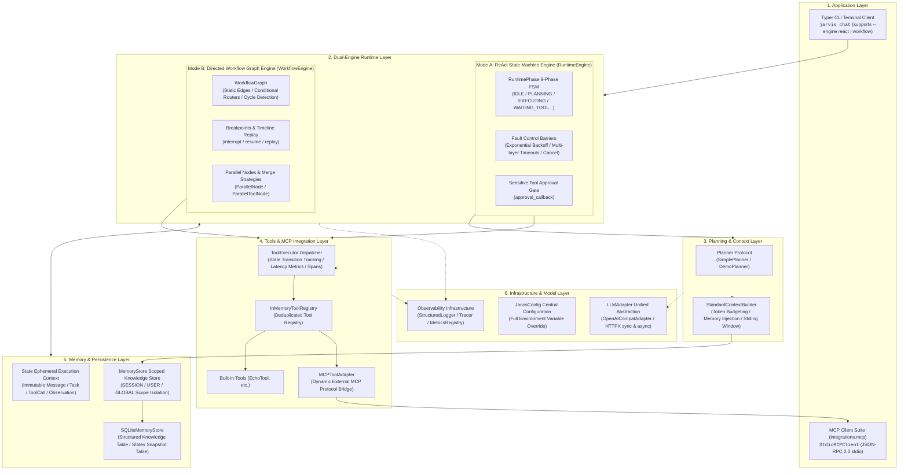
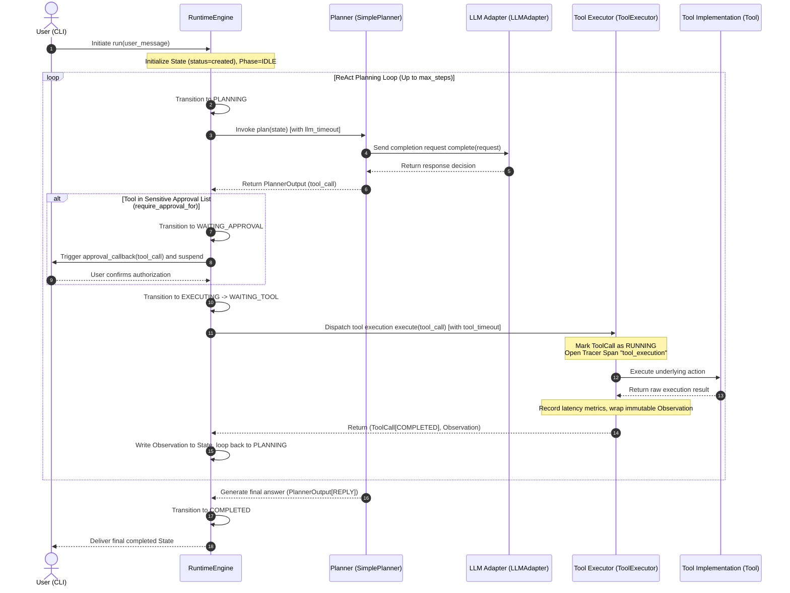
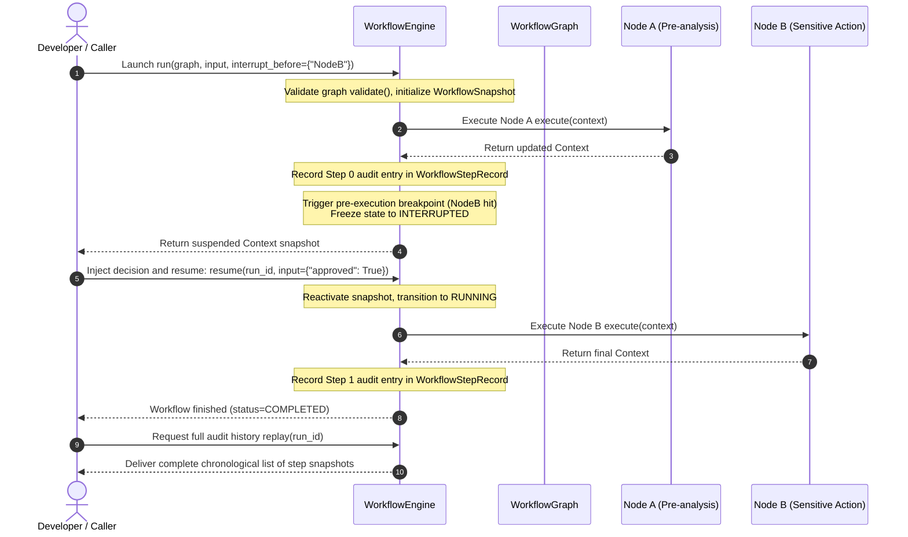

# AgentCore

> **A Modular, Transparent, and Observable Python Agent Runtime Built from Scratch**  
> *Featuring Dual Execution Engines, Layered Memory Persistence, and Native Model Context Protocol (MCP) Integration.*

[](https://www.python.org/downloads/)
[](#3-architecture)
[](https://modelcontextprotocol.io/)
[](#4-core-concepts)
[](https://github.com/astral-sh/uv)
[](https://github.com/astral-sh/ruff)
[](tests/)

[ 简体中文 ](README.md) | [ English ](README.en.md)

---

## 1. Overview

### What is AgentCore?
**AgentCore** is a lightweight, reliable, and completely white-box autonomous agent core runtime reference implementation and execution system. Without relying on heavy third-party agent wrapper frameworks (such as LangChain, LangGraph, or CrewAI), the system is built from scratch with an explicit state machine, dual execution engines (ReAct loop engine and directed workflow graph engine), layered memory persistence, sliding-window context engineering, native Model Context Protocol (MCP) standard integration, and lightweight in-memory full-lifecycle observability.

### Why does it exist?
With the rapid adoption of AI agents, developers frequently assemble prototypes using high-level frameworks. However, when transitioning to complex enterprise production environments, heavy wrapper frameworks reveal several critical engineering bottlenecks:
1. **Spaghetti Control Flow & Black-Box Abstractions**: Frameworks hide state transitions, dynamic retries, and tool calls behind multiple layers of abstraction. Troubleshooting intermittent timeouts or infinite loops becomes extremely difficult.
2. **Lack of Explicit State Machine Lifecycles**: Absence of deterministic state constraints makes it difficult to implement timeout fuses, cooperative cancellation, state auditing, and sensitive tool approval gates on running agents.
3. **Single Paradigm Inflexibility**: Exploratory open-ended tasks require autonomous model reasoning (ReAct pattern), while deterministic business pipelines (e.g., approval gates, risk control, concurrent branches) demand strict directed graph orchestration with breakpoint intervention. Forcing a single paradigm leads to brittle prompts or degraded code maintainability.
4. **Shared Mutable State & Race Conditions**: Uncontrolled in-place mutation of shared context dictionaries during parallel branch execution frequently triggers write conflicts and non-deterministic state overwrites.
5. **Brittle Context Bloat**: Unbounded appending of multi-turn chat messages and tool outputs causes token budgets to spike or exceed model context limits.
6. **Proprietary Lock-in & Tool Silos**: Relying on framework-proprietary tool abstractions prevents tools from being reused across heterogeneous microservices and ecosystems.

AgentCore adheres to a clear design philosophy: **"Explicit State Transitions, Dual-Engine Synergy, Atomic Contracts, Non-destructive Human-in-the-Loop, Standardized Ecosystem (MCP), and Full-Lifecycle Observability"**, delivering a transparent, predictable, and resilient foundation for production-grade intelligent agents.

---

## 2. Implemented Features

> **Current Status**: All planned architectural phases (V0~V4, Phase 0 ~ Phase 15) are **100% completed**, verified by 142 unit and integration tests (100% PASS).

- **Declarative Dual Execution Engines**:
  - **ReAct Loop Engine (`RuntimeEngine`)**: Explicit 9-phase state machine with built-in exponential backoff retries, multi-layer timeout protection, cooperative cancellation, and human-in-the-loop tool approval callbacks.
  - **Directed Workflow Graph Engine (`WorkflowEngine`)**: Declarative directed graph (`WorkflowGraph`) supporting conditional edge routing, pre-/post-execution breakpoints (`interrupt`), context-preserving resumption (`resume`), and historical timeline replay (`replay`).
- **9-Phase Finite State Machine & Fault Barriers (`RuntimePhase`)**:
  - Strictly defines valid states (`IDLE`, `PLANNING`, `EXECUTING`, `WAITING_TOOL`, `WAITING_APPROVAL`, `INTERRUPTED`, `COMPLETED`, `FAILED`, `CANCELLED`) to prevent illegal transitions.
  - Multi-layer timeout protection (LLM 60s, Tool 30s, Run 300s) and exponential backoff retry policies for transient planner/tool failures.
- **Topology-Level Concurrency & Deterministic Merging**:
  - `ParallelNode`: Thread-pool concurrent scheduling of sub-workflow nodes with deterministic shallow merge (`default_merge_strategy`) and namespaced merge (`namespaced_merge_strategy`) strategies to eliminate race conditions.
  - `ParallelToolNode`: Concurrent invocation of multiple independent tool calls with thread-safe observation aggregation.
- **Layered Memory & SQLite Snapshot Persistence**:
  - Strict separation between ephemeral execution state (`State`) and persistent memories (`MemoryRecord`), supporting `SESSION`, `USER`, and `GLOBAL` scope isolation with TTL expiration cleanup.
  - Native SQLite storage for structured knowledge records, unique `(key, scope)` index protection, and complete `State` session snapshot serialization and historical recovery.
- **Smart Context Engineering & Token Budgeting**:
  - `StandardContextBuilder`: Heuristic CJK/ASCII token estimator with on-demand relevant memory retrieval injected into the system prompt.
  - Sliding-window history message compression, strictly preserving system instructions and the latest user intent while automatically inserting explicit truncation markers.
- **Model Context Protocol (MCP) Native Integration**:
  - Implements the standard `MCPClient` contract with a subprocess stdio **JSON-RPC 2.0** client (`StdioMCPClient`).
  - Dynamically bridges external MCP server tools into internal `Tool` definitions via `MCPToolAdapter`, supporting one-click discovery and registration via `register_mcp_client`.
- **Lightweight Full-Lifecycle Observability (`infra.telemetry`)**:
  - Centralized Configuration (`JarvisConfig`): Complete environment variable mapping with runtime override support.
  - Structured Logger (`StructuredLogger`): Text mode for readable local debugging and JSON mode for production ingestion, with automatic context tag propagation via ContextVars.
  - Distributed Call Tracing (`Tracer` / `Span`): In-memory parent-child span linkage, precise execution timing, and exception capturing.
  - Runtime Metrics (`MetricsRegistry`): Thread-safe collection of engine start/completion/failure counters and end-to-end latency distribution snapshots.
- **Dual-Mode Terminal CLI (Typer)**:
  - `jarvis chat`: Interactive terminal chat supporting `--engine react|workflow` switching, along with `--db-path` and `--session-id` for multi-turn SQLite persistence.
- **Dual-Model LLM Adapter**:
  - **Zero-Key Offline Demo Mode**: Built-in deterministic `DemoPlanner` for immediate offline evaluation of state machine reasoning, tool loops, workflow graphs, and memory persistence.
  - **Universal OpenAI-Compatible Client**: Asynchronous and synchronous HTTPX client connecting directly to OpenAI, DeepSeek, Ollama, and vLLM endpoints.

---

## 3. Architecture

AgentCore enforces a seven-layer decoupled microkernel architecture with strict downward-only dependencies, isolating core runtime logic from external communication protocols:

### Architecture Topology



---

### Core Sequence Diagrams

#### 1. ReAct Loop & Sensitive Tool Human-in-the-Loop (HITL) Approval Sequence



#### 2. Workflow Graph Breakpoint Interruption, Resume, and Timeline Replay Sequence



---

## 4. Core Concepts

| Core Concept | Definition & Role in AgentCore |
| :--- | :--- |
| **`Message`** | Atomic interaction unit. Strongly typed immutable object (`frozen=True`) strictly defining `user`, `assistant`, `system`, and `tool` roles. |
| **`State`** | Ephemeral, run-scoped execution trace for a single Agent execution. Contains messages, active task, tool calls, and reasoning history. |
| **`Task`** | Structured task representation. Supports goal specification and recursive subtasks (`subtasks`) for hierarchical decomposition. |
| **`RuntimeEngine`** | ReAct loop engine for exploratory tasks. Dynamically plans next steps with built-in retry backoff and timeout fuses. |
| **`RuntimePhase`** | 9-phase finite state machine. Formally restricts lifecycle transitions, preventing undefined intermediate states. |
| **`WorkflowEngine`** | Directed graph execution engine for deterministic business pipelines. Supports conditional routing, concurrency, breakpoints (HITL), and replay. |
| **`WorkflowGraph`** | Directed topological graph container. Validates entry points and edge integrity with cycle-detection step limits. |
| **`ParallelNode`** | Topology-level concurrent execution node. Concurrently dispatches sub-workflow nodes with shallow and namespaced merge strategies. |
| **`MemoryRecord`** | Long-term knowledge item. Distinct from ephemeral `State`, supporting `SESSION`, `USER`, and `GLOBAL` scopes with TTL expiration. |
| **`StandardContextBuilder`** | Context engineering engine. Retrieves relevant memories by token budget, estimates CJK/ASCII costs, and compresses history via sliding windows. |
| **`Tool` & `Observation`** | Tool contract and immutable result. Parameters validated against JSON Schema; results packaged into correlation-stamped `Observation` records. |
| **`MCPClient`** | Model Context Protocol standard client. Communicates with external independent subprocess MCP servers via JSON-RPC 2.0 stdio. |
| **`Tracer` & `Span`** | Lightweight in-memory distributed call tracing. Automatically chains parent-child spans, tracking execution durations with zero dependencies. |

---

## 5. Project Structure

```text
AgentCore/
├── runtime/              # Core runtime engine (Message/State/Task models, 9-phase FSM, RuntimeEngine, AgentLoop)
├── workflow/             # Workflow orchestration (WorkflowGraph, FunctionNode, ParallelNode, interrupt/resume/replay)
├── planner/              # Planning layer (Planner protocol, PlannerOutput schema, SimplePlanner)
├── tools/                # Tooling system (Tool contract, InMemoryToolRegistry, ToolExecutor, built-in Echo tool)
├── memory/               # Memory & context (MemoryRecord, InMemory/SQLite stores, StandardContextBuilder)
├── llm/                  # Model abstraction (LLMAdapter protocol, HTTPX-based OpenAICompatAdapter)
├── integrations/         # Integrations & protocol adapters
│   ├── cli/              # Terminal CLI application (Typer CLI app, chat command)
│   └── mcp/              # MCP standard protocol client (StdioMCPClient JSON-RPC 2.0, MCPToolAdapter)
├── infra/                # Infrastructure (JarvisConfig central config, StructuredLogger, Tracer, MetricsRegistry)
├── docs/                 # Standardized technical documentation (architecture, design, guides, ADRs, roadmap)
│   ├── architecture/     # Overall architecture and execution sequences
│   ├── design/           # Component design deep-dives
│   ├── development/      # Developer setup and engineering standards
│   ├── adr/              # Architecture Decision Records (ADR-001 ~ ADR-004)
│   ├── roadmap/          # Evolution roadmap and capability matrix
│   └── archive/          # Archived historical bootstrap documents
├── tests/                # Comprehensive automated test suite (142 passing tests, 100% PASS)
├── pyproject.toml        # Build configuration and tooling (Hatchling, uv, Ruff, Black, pytest)
└── README.md             # Repository home (Default: Simplified Chinese)
```

---

## 6. Getting Started

### 6.1 Prerequisites
- **Python**: `>= 3.12` (validated on Python 3.12 and Python 3.14)
- **Package Manager**: [uv](https://github.com/astral-sh/uv) (recommended for deterministic performance)

### 6.2 Installation & Dependency Sync
```bash
# Clone the repository
git clone https://github.com/PublicYang/AgentCore.git
cd AgentCore

# Synchronize virtual environment with dev dependencies (pytest, ruff, black, pre-commit)
uv sync --extra dev
```

### 6.3 Quick Evaluation (Zero-Key Offline Demo Mode)

Evaluate state machine loops, tool calls, and workflow graphs without any API keys or network access:

```bash
# 1. Offline single-turn chat with ReAct engine
uv run jarvis chat --demo "Hello, AgentCore"

# 2. Trigger built-in echo tool loop
uv run jarvis chat --demo "echo Hello AgentCore"

# 3. Offline chat using Workflow Graph engine (--engine workflow)
uv run jarvis chat --demo --engine workflow "echo Testing Workflow"

# 4. Multi-turn chat with local SQLite memory persistence
uv run jarvis chat --demo --db-path "agent.db" --session-id "sess_001" "My name is Alice"
uv run jarvis chat --demo --db-path "agent.db" --session-id "sess_001" "echo Read Session History"
```

> **Note**: The CLI script entry point registered in `pyproject.toml` is `jarvis`. Run commands using `uv run jarvis <command>`.

### 6.4 Connecting to Real LLMs (OpenAI-compatible)

AgentCore natively connects to any model service supporting the OpenAI specification (OpenAI, DeepSeek, Ollama, etc.):

```bash
# Method A: Configure via environment variables
export JARVIS_API_KEY="sk-YOUR_API_KEY"
export JARVIS_BASE_URL="https://api.openai.com/v1" # or compatible endpoint
export JARVIS_MODEL="gpt-4o-mini"

uv run jarvis chat "Explain how finite state machines work"

# Method B: Specify flags directly via CLI
uv run jarvis chat --api-key "sk-YOUR_API_KEY" --model "gpt-4o-mini" "Hello!"

# Online conversation with SQLite session persistence
uv run jarvis chat --api-key "sk-YOUR_API_KEY" --db-path "agent.db" --session-id "user_alice" "Remember that I like Python"
```

### 6.5 Running Full Test Suite
```bash
# Run all 142 unit and integration tests
uv run pytest

# Quiet mode
uv run pytest -q
```
*All 142 automated tests pass in approximately 2 seconds (100% PASS).*

---

## 7. Configuration

AgentCore supports configuration overrides via environment variables or CLI options:

| Environment Variable | CLI Option | Default | Description |
| :--- | :--- | :--- | :--- |
| `JARVIS_API_KEY` | `--api-key` | `None` | LLM API key (sensitive credential, do not commit). |
| `JARVIS_BASE_URL` | `--base-url` | `https://api.openai.com/v1` | OpenAI-compatible endpoint Base URL. |
| `JARVIS_MODEL` | `--model` | `gpt-4o-mini` | Target LLM model identifier. |
| `JARVIS_LLM_TIMEOUT` | - | `60.0` | Individual LLM call timeout in seconds. |
| `JARVIS_ENGINE` | `--engine` / `-e` | `react` | Default execution engine: `react` or `workflow`. |
| `JARVIS_MAX_STEPS` | - | `8` | Maximum planning steps permitted per turn. |
| `JARVIS_DB_PATH` | `--db-path` | `None` (in-memory) | SQLite database path for persistent memory. |
| `JARVIS_SESSION_ID`| `--session-id` | `None` | Session ID for continuity and state snapshot recovery. |
| `JARVIS_LOG_LEVEL` | - | `INFO` | Logging output level (`DEBUG`, `INFO`, `WARNING`, `ERROR`). |
| `JARVIS_LOG_FORMAT`| - | `text` | Log format: `text` (local debugging) or `json` (production). |
| `JARVIS_TRACE_ENABLED` | - | `True` | Enable/disable in-memory call tracing (`Tracer`). |
| `JARVIS_METRICS_ENABLED` | - | `True` | Enable/disable runtime metrics collection (`MetricsRegistry`). |

---

## 8. Development & Quality Gates

The codebase strictly adheres to automated quality gate disciplines. All changes must pass linting and tests prior to merging:

```bash
# 1. Run Ruff linter and import sorting checks
uv run ruff check .

# 2. Run Black code formatting check
uv run black --check .

# 3. Install and run pre-commit quality gate
uv run pre-commit install
uv run pre-commit run --all-files

# 4. Execute automated test suite
uv run pytest -v
```

---

## 9. Documentation

Standardized architecture and engineering deep-dives are maintained in the `docs/` directory:

```text
docs/
├── architecture/                     # Architecture specifications
│   ├── overview.md                   # 7-layer microkernel architecture and dependency rules
│   └── runtime-flow.md               # 9-phase state machine transitions and execution sequences
├── design/                           # Detailed component designs
│   ├── domain-models.md              # Immutable domain models (Message, State, Task, ToolCall)
│   ├── dual-engine.md                # Dual execution engines comparison, concurrency, and replay
│   ├── tool-and-mcp.md               # Tool contract, executor metrics, and MCP JSON-RPC 2.0 stdio
│   ├── memory-and-context.md         # State vs Memory isolation, SQLite storage, and token budgeting
│   └── observability.md              # Central config, dual-format logs, tracing spans, and metrics
├── development/                      # Developer resources
│   ├── guide.md                      # Developer setup, dependencies, and CLI user guide
│   └── standards.md                  # Engineering standards, type safety, and Conventional Commits
├── adr/                              # Architecture Decision Records
│   ├── ADR-001-runtime-self-build.md # ADR-001: Self-built core runtime (avoiding framework lock-in)
│   ├── ADR-002-layered-architecture.md# ADR-002: Seven-layer strict unidirectional architecture
│   ├── ADR-003-framework-introduction-strategy.md # ADR-003: External framework policy & embracing MCP
│   └── ADR-004-dual-execution-engines.md # ADR-004: Dual execution engines (ReAct + Workflow Graph)
├── roadmap/                          # Evolution planning
│   └── roadmap.md                    # Sixteen-phase evolution overview and capability matrix
└── archive/                          # Historical archives
    └── legacy_master_plan/           # Early bootstrap phase documents (preserving Git history)
```

---

## 10. Roadmap

All sixteen planned development phases (Phase 0 ~ Phase 15) for AgentCore are **100% completed and verified**:

### Completed
- ✅ **V0: Foundation (Architecture & Infrastructure)**
  - **Phase 0: Design Gate**: Architecture blueprint, conceptual mapping, and ADR decisions.
  - **Phase 1: Project Skeleton**: Modern project layout, package boundaries, and dependency isolation.
  - **Phase 2: Dev Infrastructure**: uv, Ruff, Black, pytest infrastructure, and pre-commit gates.
  - **Phase 3: Runtime Foundation**: Immutable `Message`, `State`, and `Task` Pydantic v2 models.
- ✅ **V1: Core Runtime (ReAct Engine & Closed-Loop Tooling)**
  - **Phase 4: LLM Adapter**: `LLMAdapter` unified protocol and HTTPX-based `OpenAICompatAdapter`.
  - **Phase 5: Planner**: `Planner` protocol, validated `PlannerOutput`, and `SimplePlanner`.
  - **Phase 6: Tool Calling**: Tool contract, `InMemoryToolRegistry`, `ToolExecutor`, and minimal sync loop.
  - **Phase 7: Runtime Loop**: 9-phase FSM, exponential backoff, multi-layer timeouts, approvals, and CLI.
- ✅ **V2: Stateful Agent (Memory & Persistence)**
  - **Phase 8: Memory Foundation**: Scoped memory models (`MemoryRecord`) and thread-safe `InMemoryMemoryStore`.
  - **Phase 9: Context Engineering**: `StandardContextBuilder`, token estimation, and sliding window budgeting.
  - **Phase 10: Persistence**: `SQLiteMemoryStore`, unique `(key, scope)` index, and State snapshot recovery.
- ✅ **V3: Workflow Engine (Directed Graph & Concurrency)**
  - **Phase 11: Workflow Foundation**: `WorkflowNode`, `WorkflowEdge`, conditional routing, and `WorkflowGraph`.
  - **Phase 12: State Machine Upgrade**: `WorkflowEngine` breakpoints (`interrupt`), resumption (`resume`), and timeline replay (`replay`).
  - **Phase 13: Parallel Execution**: Thread-pool concurrent nodes (`ParallelNode`), concurrent tools (`ParallelToolNode`), and merge strategies.
- ✅ **V4: Production Agent (Hardening & Ecosystem Standards)**
  - **Phase 14: MCP Integration**: Model Context Protocol standard client and subprocess stdio JSON-RPC 2.0 adapter.
  - **Phase 15: Production Hardening**: Central configuration (`JarvisConfig`), structured logging, tracing spans (`Tracer`/`Span`), and metrics (`MetricsRegistry`).

### Future & Extension Outlook
- [ ] **Native Tool Call Schema Injection**: Direct tool JSON Schema injection in `OpenAICompatAdapter` allowing `SimplePlanner` to automatically parse model-generated `tool_calls`.
- [ ] **Web API & WebSocket Service**: Asynchronous streaming (SSE) endpoints and multi-tenant session management based on FastAPI.
- [ ] **RAG Vector Hybrid Search Subsystem**: Document chunking, embedding adapter, and local SQLite-vec / Chroma vector store.
- [ ] **Multi-Agent Swarm**: Inter-agent communication protocols and hierarchical supervisor orchestration via `WorkflowGraph`.

---

## 📄 License

TBD (See repository headers)
