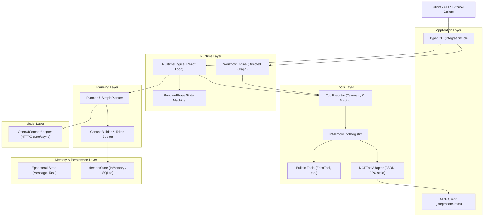

# AgentCore

<p align="center">
  <strong>A Modular, Transparent, and Observable Python Agent Runtime Built from Scratch.</strong>
</p>

<p align="center">
  
  
  
  
  
  
  
</p>

<p align="center">
  <a href="README.md"><strong>中文</strong></a> | <a href="README.en.md"><strong>English</strong></a>
</p>

---

## 📖 Overview

### What is AgentCore?
**AgentCore** is a lightweight, modular, and white-box Python AI Agent runtime built from scratch. It avoids dependencies on heavy third-party agent frameworks (such as LangChain, LangGraph, or CrewAI). Through clean architectural layering and explicit state machines, AgentCore provides a complete closed-loop runtime for input planning, tool invocation, memory persistence, directed workflow graph orchestration, and standardized ecosystem integration.

### Why does it exist?
1. **Eliminate Black-Box Abstractions**: Mainstream agent frameworks often encapsulate state transitions, tool dispatching, and token budgeting behind opaque abstractions, making debugging and troubleshooting painful. AgentCore insists on transparent, white-box control flows where all state changes and lifecycles are explicitly defined in code.
2. **Dual Execution Engines for Diverse Scenarios**: AgentCore natively provides both a **ReAct State Machine Engine** for autonomous, exploratory decision-making and a **Directed Workflow Graph Engine** for deterministic, enterprise-grade business pipelines.
3. **Embrace Open Standards**: Rather than locking into proprietary plugin ecosystems, AgentCore natively implements the **Model Context Protocol (MCP)**, enabling out-of-the-box interoperability with modern external tools.

---

## ✨ Core Features (Implemented)

* 🔄 **Dual Execution Engines**:
  * **ReAct State Machine Engine (`RuntimeEngine`)**: Explicit 9-phase state machine with built-in exponential backoff retries, multi-layer timeout protection, cooperative cancellation, and human-in-the-loop tool approval callbacks.
  * **Directed Workflow Graph Engine (`WorkflowEngine`)**: Supports conditional edge routing (`WorkflowGraph`), pre-/post-execution breakpoints (`interrupt`), human input resumption (`resume`), and historical timeline replay (`replay`).
* ⚡ **Concurrent Execution Nodes (`ParallelNode` / `ParallelToolNode`)**:
  * Concurrent sub-node and tool execution via thread pools, offering deterministic shallow merge and namespaced merge strategies with zero race conditions.
* 🧠 **Layered Memory & SQLite Persistence (`MemoryStore`)**:
  * Clear separation between ephemeral runtime state (`State`) and persistent memories (`MemoryRecord`), supporting `SESSION`, `USER`, and `GLOBAL` scope isolation with TTL expiration cleanup.
  * Native SQLite storage for structured memory persistence and complete session snapshot recovery.
* 🎛️ **Smart Context Engineering & Token Budgeting (`StandardContextBuilder`)**:
  * Heuristic token estimation for CJK and ASCII characters, on-demand relevant memory injection, sliding-window compression, and explicit truncation notices.
* 🔌 **Model Context Protocol (MCP) Native Integration**:
  * Implements the standard `MCPClient` contract with subprocess stdio **JSON-RPC 2.0** communication; external MCP tools are automatically discovered and adapted into internal tool definitions.
* 📊 **Lightweight In-Memory Observability (`infra.telemetry`)**:
  * Dual-format structured logging (Text / JSON), automatic context propagation via ContextVars, hierarchical tracing spans (`Tracer` / `Span`), and runtime metrics collection (`MetricsRegistry`).
* 💻 **Dual-Engine Typer CLI**:
  * Feature-rich CLI supporting seamless switching between `--engine react|workflow`, offline mock execution, and live LLM integration.

---

## 🏛️ System Architecture



---

## 💡 Core Concepts

* **`State` vs `Memory`**: `State` represents the ephemeral, run-scoped execution trace (conversation messages, active task, tool calls, and observations); `Memory` represents persistent knowledge units retained across turns and sessions with scope isolation and TTL expiration.
* **`RuntimeEngine` vs `WorkflowEngine`**: The former relies on LLM autonomous reasoning to decide next steps dynamically (ReAct loop); the latter follows developer-defined directed graphs and conditional predicates with breakpoint interruptions for Human-in-the-Loop workflows.
* **`Tool` & `Observation`**: Tool contracts strictly define parameters using JSON Schema. Tool execution results are encapsulated as immutable `Observation` records stamped with correlation IDs.
* **`MCP Integration`**: Leverages the open Model Context Protocol standard to connect external tool servers, avoiding proprietary lock-in.

---

## 📁 Project Structure

```text
AgentCore/
├── runtime/              # Core runtime: Message/State/Task models, 9-phase state machine, RuntimeEngine
├── workflow/             # Workflow engine: WorkflowGraph, FunctionNode, ParallelNode, breakpoints & replay
├── planner/              # Decision layer: Planner protocol, PlannerOutput, SimplePlanner
├── tools/                # Tooling: Tool protocol, InMemoryToolRegistry, ToolExecutor, built-in tools
├── memory/               # Memory & context: MemoryRecord, InMemory/SQLite stores, ContextBuilder
├── llm/                  # Model abstraction: LLMAdapter protocol, OpenAICompatAdapter (HTTPX)
├── integrations/         # Integrations: Typer CLI entry point, MCP Client (JSON-RPC 2.0 stdio)
├── infra/                # Infrastructure: Central config (JarvisConfig), structured logs, tracing, metrics
├── tests/                # Automated test suite (142 passing tests)
├── docs/                 # Standardized documentation (architecture, design, guides, ADRs, roadmap)
├── pyproject.toml        # Build and tooling config (Hatchling, uv, Ruff, Black, pytest)
└── README.md             # Project portal (Default: Chinese)
```

---

## 🚀 Getting Started

### 1. Prerequisites
* Python $\ge$ 3.12
* Recommended package manager: [uv](https://github.com/astral-sh/uv)

### 2. Installation & Environment Sync
```bash
# Sync dependencies including dev tools (pytest, ruff, black, pre-commit)
uv sync --extra dev
```

### 3. Run Test Suite
```bash
# Verify all 142 automated tests pass
uv run pytest
```

### 4. Command-Line Interface (CLI)

#### Offline Demos (No API Key Required)
```bash
# 1. Offline single-turn chat with ReAct engine
uv run jarvis chat --demo "Hello, AgentCore"

# 2. Trigger built-in echo tool
uv run jarvis chat --demo "echo Hello AgentCore"

# 3. Offline chat using Workflow Graph engine
uv run jarvis chat --demo --engine workflow "echo Testing Workflow"

# 4. Multi-turn chat with local SQLite memory persistence
uv run jarvis chat --demo --db-path "agent.db" --session-id "sess_001" "My name is Alice"
uv run jarvis chat --demo --db-path "agent.db" --session-id "sess_001" "echo Read Session"
```

#### Online Chat with OpenAI-Compatible LLMs
```bash
# Set environment variables
export JARVIS_API_KEY="sk-YOUR_API_KEY"
export JARVIS_BASE_URL="https://api.openai.com/v1" # or third-party compatible endpoint
export JARVIS_MODEL="gpt-4o-mini"

# Online turn
uv run jarvis chat "Explain how finite state machines work"

# Online turn with SQLite session persistence
uv run jarvis chat --db-path "agent.db" --session-id "my_user" "Remember that I like Python"
```

---

## ⚙️ Configuration

AgentCore supports configuration overrides via environment variables or CLI flags:

| Environment Variable | CLI Option | Default | Description |
| :--- | :--- | :--- | :--- |
| `JARVIS_API_KEY` | `--api-key` | `None` | LLM API key (sensitive, do not commit) |
| `JARVIS_BASE_URL` | `--base-url` | `https://api.openai.com/v1` | OpenAI-compatible endpoint Base URL |
| `JARVIS_MODEL` | `--model` | `gpt-4o-mini` | Target LLM model name |
| `JARVIS_ENGINE` | `--engine` / `-e` | `react` | Default execution engine: `react` or `workflow` |
| `JARVIS_DB_PATH` | `--db-path` | `None` (in-memory) | SQLite database path for persistent memory |
| `JARVIS_SESSION_ID`| `--session-id` | `None` | Session ID for continuity and state recovery |
| `JARVIS_MAX_STEPS` | - | `8` | Maximum planning steps permitted per turn |
| `JARVIS_LOG_FORMAT`| - | `text` | Log format: `text` (local debugging) or `json` (production) |

> [!NOTE]
> Environment variables currently use the `JARVIS_*` prefix for backward compatibility and will seamlessly support `AGENTCORE_*` aliases in an upcoming minor release.

---

## 🛠️ Development & Engineering Standards

```bash
# 1. Run code linting (Ruff)
uv run ruff check .

# 2. Format code (Black)
uv run black .

# 3. Install and run pre-commit checks
uv run pre-commit install
uv run pre-commit run --all-files
```

---

## 🗺️ Roadmap & Capability Status

| Phase | Scope | Status |
| :--- | :--- | :--- |
| **V0 Foundation** | Domain models (Message/State/Task), dev infra, quality gates | ✅ **Completed** |
| **V1 Core Runtime**| ReAct 9-phase state machine, LLM adapter, tool registry & closed loop | ✅ **Completed** |
| **V2 Stateful Agent**| Scoped memory (MemoryRecord), SQLite persistence, sliding window budget | ✅ **Completed** |
| **V3 Workflow** | Directed graph (WorkflowGraph), interrupt/resume/replay, parallel nodes | ✅ **Completed** |
| **V4 Production** | MCP JSON-RPC 2.0 client & adapter, structured logs, tracing & metrics | ✅ **Completed** |
| **V4.1 In Progress**| LLM native function call parsing (`SimplePlanner`), MCP resource context linking | 🟡 **In Progress** |
| **V5 Planned** | FastAPI HTTP / WebSocket API service, SSE streaming responses | 🔵 **Planned** |
| **V6 Planned** | Knowledge base & RAG retrieval subsystem (chunking, embedding, hybrid search) | 🔵 **Planned** |
| **V7 Planned** | Multi-agent communication protocols and supervisor orchestration | 🔵 **Planned** |

For full roadmap details, see: [Master Evolution Roadmap](docs/roadmap/roadmap.md).

---

## 📚 Documentation Navigation

Complete engineering documentation directory:

```text
docs/
├── architecture/                     # Architecture specifications
│   ├── overview.md                   # System layering and dependency rules
│   └── runtime-flow.md               # State machine sequence and workflow graph flows
├── design/                           # Component design deep dives
│   ├── domain-models.md              # Domain models and lifecycle
│   ├── dual-engine.md                # Dual execution engines comparison and design
│   ├── tool-and-mcp.md               # Tool contract, executor, and MCP integration
│   ├── memory-and-context.md         # Memory isolation and sliding window context engineering
│   └── observability.md              # Structured logging, tracing spans, and metrics
├── development/                      # Developer resources
│   ├── guide.md                      # Setup and CLI developer guide
│   └── standards.md                  # Code formatting and Git commit conventions
├── adr/                              # Architecture Decision Records
│   ├── ADR-001-runtime-self-build.md # ADR-001: Self-built core runtime
│   ├── ADR-002-layered-architecture.md# ADR-002: Seven-layer decoupled architecture
│   ├── ADR-003-framework-introduction-strategy.md # ADR-003: External framework policy
│   └── ADR-004-dual-execution-engines.md # ADR-004: Dual execution engines design
├── roadmap/                          # Evolution planning
│   └── roadmap.md                    # Capability boundaries and future milestones
└── archive/                          # Historical archives
    └── legacy_master_plan/           # Early bootstrap phase documents
```

---

## 📄 License

TBD (See repository headers)
