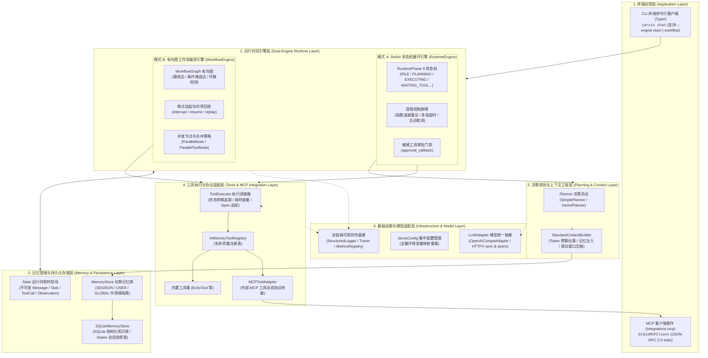
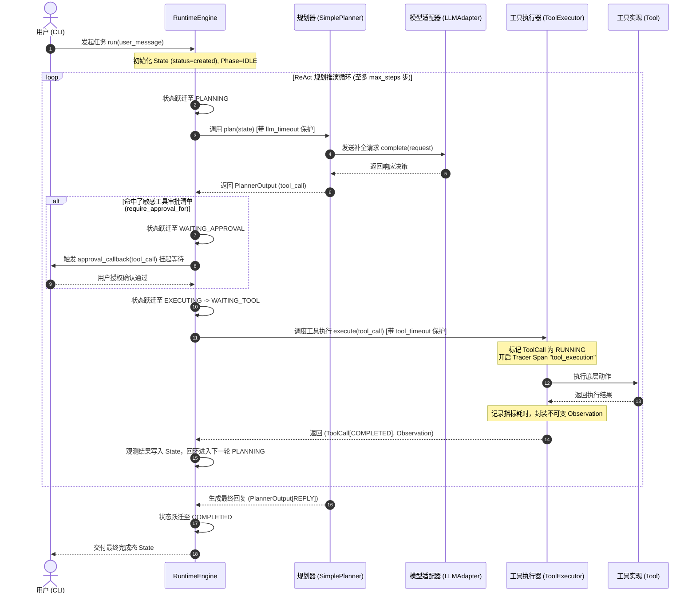
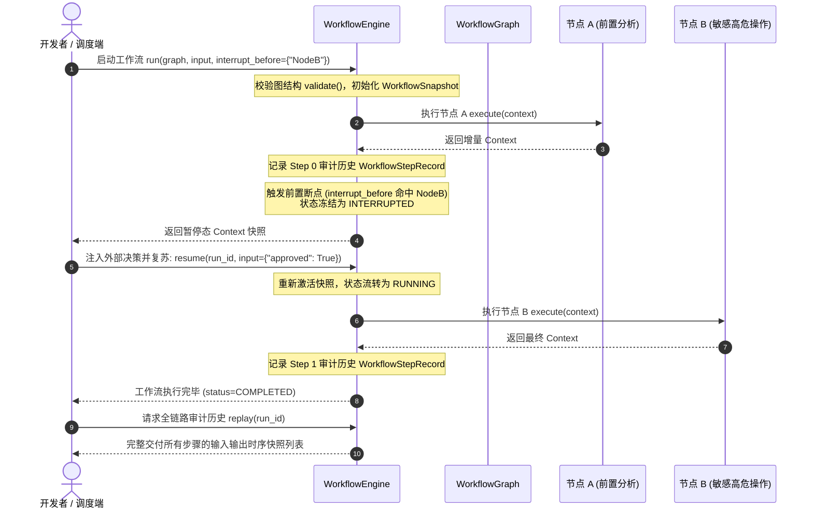

# AgentCore

> **从零实现的轻量级、模块化、白盒化 Python 智能体核心运行时系统**  
> *A Modular, Transparent, and Observable Python Agent Runtime Built from Scratch, featuring Dual Execution Engines and Native MCP Integration.*

[](https://www.python.org/downloads/)
[](#3-architecture-系统架构)
[](https://modelcontextprotocol.io/)
[](#4-core-concepts-核心概念)
[](https://github.com/astral-sh/uv)
[](https://github.com/astral-sh/ruff)
[](tests/)

[ 简体中文 ](README.md) | [ English ](README.en.md)

---

## 1. Overview (项目概览)

### What is AgentCore?
**AgentCore** 是一个轻量级、高可靠、完全白盒化的自主智能体（Autonomous Agent）核心运行时参考实现与执行系统。项目不依赖任何重型第三方 Agent 封装框架（如 LangChain、LangGraph、CrewAI 等），从零构建了包含显式状态机、双执行引擎（ReAct 循环引擎与有向图工作流引擎）、分层记忆持久化、滑动窗口上下文工程、原生 Model Context Protocol (MCP) 标准接入以及轻量级全链路可观测性的工业级 Agent 运行内核。

### Why does it exist?
在智能体技术快速普及的背景下，开发者通常直接使用成熟的高阶框架构建 Demo。然而，当面临复杂企业级业务场景时，重型框架往往暴露出以下难以逾越的工程瓶颈：
1. **控制流面条化与黑盒封装**: 框架将状态跃迁、动态重试、工具调用隐藏在层层封装中，一旦发生偶发超时或死循环，排查与干预极度艰难。
2. **缺乏显式状态机生命周期**: 状态变化缺乏确定性约束，难以对运行中的 Agent 实施超时熔断、主动取消、状态追溯与敏感操作拦截。
3. **单一范式无法兼顾探索与确定性**: 探索式未知任务需要模型自主推理规划（ReAct 模式），而确定性业务流水线（如审批、风控、多节点并发）则需要严格的拓扑图编排与断点干预能力。强行使用单一模式会导致 Prompt 极度脆弱或代码高度腐化。
4. **状态共享与并发竞态**: 共享可变上下文在多分支并发执行时频繁引发脏写冲突与不可预测的状态覆盖。
5. **脆弱的上下文膨胀**: 长会话与工具输出无限追加导致 Token 预算骤增甚至超出模型上下文窗口。
6. **私有插件绑定与工具孤岛**: 依赖各框架私有的 Tool 抽象导致工具无法跨技术栈复用。

AgentCore 坚持**“状态显式化、双引擎协同、契约原子化、人机审批无损化、生态标准化 (MCP)、观测全链路化”**的设计哲学，为构建可预测、可审计、高可控的生产级智能体应用提供纯粹坚固的运行时底座。

---

## 2. Implemented Features (已实现核心能力)

> **当前状态**: 本项目全阶段规划（V0~V4，Phase 0 ~ Phase 15）已**全部开发完成**，并通过 142 项单元与集成测试验证（100% PASS）。

- **声明式双执行引擎体系 (Dual Execution Engines)**:
  - **ReAct 循环引擎 (`RuntimeEngine`)**: 显式 9 状态跃迁机，内置指数退避重试、多层超时保护、协作式主动取消与敏感工具审批回调。
  - **有向图工作流引擎 (`WorkflowEngine`)**: 声明式有向图 (`WorkflowGraph`)，支持条件边动态路由、节点前置/后置断点挂起 (`interrupt`)、带上下文无损复苏 (`resume`) 与全生命周期时序审计回放 (`replay`)。
- **9 状态有限状态机与容错屏障 (Runtime State Machine)**:
  - 严格定义 `RuntimePhase`（`IDLE`, `PLANNING`, `EXECUTING`, `WAITING_TOOL`, `WAITING_APPROVAL`, `INTERRUPTED`, `COMPLETED`, `FAILED`, `CANCELLED`），防范非法跳转。
  - 多层超时防御（LLM 60s、Tool 30s、Run 300s）与针对 Planner/Tool 偶发失败的指数退避重试（Exponential Backoff）。
- **拓扑级并发执行与确定性规约 (Parallel Execution)**:
  - `ParallelNode`: 基于线程池并发调度子工作流节点，提供确定性浅合并（`default_merge_strategy`）与命名空间合并（`namespaced_merge_strategy`），杜绝并发脏写。
  - `ParallelToolNode`: 并发调度多个独立工具调用，无竞态安全追加观察结果。
- **分层记忆体系与 SQLite 快照持久化 (Memory & Persistence)**:
  - 显式区分运行现场 (`State`) 与长期知识条目 (`MemoryRecord`)，支持 `SESSION` / `USER` / `GLOBAL` 作用域隔离与 TTL 过期淘汰。
  - 原生基于 SQLite 实现结构化知识落盘、`(key, scope)` 唯一键防覆盖索引以及完整的 State 会话快照序列化存储与历史恢复。
- **智能上下文工程与 Token 预算控制 (Context Engineering)**:
  - `StandardContextBuilder`: 启发式 CJK/ASCII Token 估算器，相关记忆按需检索并结构化注入系统提示词。
  - 滑动窗口历史消息压缩，始终刚性保留系统提示词与最新用户意图，自动插入显式截断标记。
- **Model Context Protocol (MCP) 原生集成**:
  - 原生实现标准 `MCPClient` 契约，支持基于子进程 stdio 的 **JSON-RPC 2.0** 通信客户端（`StdioMCPClient`）。
  - 通过 `MCPToolAdapter` 动态将外部 MCP Server 工具适配为内核 `Tool` 协议，提供 `register_mcp_client` 一键自动发现与注册。
- **轻量级全链路可观测性基建 (Observability & Telemetry)**:
  - 集中配置中心 (`JarvisConfig`): 支持全量环境变量映射与运行时覆盖。
  - 结构化日志 (`StructuredLogger`): 支持本地调试 Text 模式与生产采集 JSON 模式，依托 ContextVars 自动透传上下文标签。
  - 分布式链路追踪 (`Tracer` / `Span`): 内存级父子跨度自动串联、耗时精确计量与异常捕获。
  - 运行时指标度量 (`MetricsRegistry`): 线程安全收集引擎启动/完成/失败计数器及端到端延迟分布快照。
- **双模终端命令行客户端 (Typer CLI)**:
  - `jarvis chat`: 交互式终端会话，支持 `--engine react|workflow` 自由切换引擎，支持 `--db-path` 与 `--session-id` 多轮会话持久化。
- **双模大模型适配**:
  - **离线确定性 Demo 模式**: 内置 `DemoPlanner`，零 API Key、零外部网络即可完整体验状态机推演、工具调用闭环、工作流图路由与记忆持久化。
  - **通用 OpenAI 兼容协议**: 基于 `httpx` 直连 OpenAI、DeepSeek、Ollama、vLLM 等主流模型服务。

---

## 3. Architecture (系统架构)

AgentCore 采用严格的七层分层微内核架构，层间遵循单向依赖规则，核心业务逻辑完全与外部协议解耦：

### 架构拓扑 (Architecture Topology)



---

### 核心流转时序 (Sequence Diagrams)

#### 1. ReAct 状态循环与敏感工具人机审批时序



#### 2. 有向图工作流断点挂起、人工干预恢复与时序回放时序



---

## 4. Core Concepts (核心概念)

| 核心概念 | 定义与在 AgentCore 中的职责 |
| :--- | :--- |
| **`Message`** | 对话交互的基本原子。强类型不可变对象（`frozen=True`），严格规范 `user` / `assistant` / `system` / `tool` 角色。 |
| **`State`** | 单次 Agent 运行实例（Run）的完整即时现场。包含对话消息序列、当前任务、工具调用追踪与推理历史。 |
| **`Task`** | 结构化任务载体。支持目标（goal）定义与递归子任务列表（`subtasks`），为复杂任务拆解预留。 |
| **`RuntimeEngine`** | 面向自主探索任务的 ReAct 循环引擎。由大模型与规划器动态推演下一步动作，内建完备的容错重试与超时控制。 |
| **`RuntimePhase`** | 9 状态有限状态机。显式规范生命周期合法跃迁路径，杜绝未知中间态。 |
| **`WorkflowEngine`** | 面向确定性业务流程的有向图执行引擎。支持条件路由、多节点并发、断点挂起（HITL）与时序审计回放。 |
| **`WorkflowGraph`** | 有向拓扑图载体。严格校验入口点（Entry Point）、节点有效性，并提供环路最大步数熔断保护。 |
| **`ParallelNode`** | 拓扑级并发执行节点。基于线程池安全并发调度多个子工作流节点，提供浅合并与命名空间合并策略。 |
| **`MemoryRecord`** | 长期持久化知识条目。严格区隔于即时 `State`，支持 `SESSION` / `USER` / `GLOBAL` 作用域隔离与 TTL 过期淘汰。 |
| **`StandardContextBuilder`** | 智能上下文工程构建器。按 Token 预算动态检索相关记忆、估算 CJK/ASCII 开销并通过滑动窗口压缩历史。 |
| **`Tool` & `Observation`** | 工具契约与观察结果。参数基于 JSON Schema 严格校验，返回结果封装为附带调用 ID 的不可变 `Observation`。 |
| **`MCPClient`** | Model Context Protocol 标准客户端。实现与外部独立子进程 MCP Server 的 JSON-RPC 2.0 stdio 协议通信。 |
| **`Tracer` & `Span`** | 轻量级分布式调用链路追踪基建。自动串联父子跨度，精确记录执行耗时与异常，零外部依赖。 |

---

## 5. Project Structure (关键目录结构)

```text
AgentCore/
├── runtime/              # 核心运行时引擎 (Message/State/Task 领域模型, 9 状态机, RuntimeEngine, AgentLoop)
├── workflow/             # 工作流编排引擎 (WorkflowGraph, FunctionNode, ParallelNode, 断点挂起/恢复/回放)
├── planner/              # 决策规划层 (Planner 抽象协议, PlannerOutput 校验模型, SimplePlanner 规划器)
├── tools/                # 工具执行系统 (Tool 契约, InMemoryToolRegistry, ToolExecutor, 内置 Echo 工具)
├── memory/               # 记忆与上下文工程 (MemoryRecord, InMemory/SQLite 存储后端, StandardContextBuilder)
├── llm/                  # 大模型适配层 (LLMAdapter 统一协议, 基于 HTTPX 的 OpenAICompatAdapter)
├── integrations/         # 接入与协议适配层
│   ├── cli/              # 终端应用入口 (Typer CLI app, chat 命令行交互)
│   └── mcp/              # MCP 标准协议客户端 (StdioMCPClient JSON-RPC 2.0, MCPToolAdapter)
├── infra/                # 基础设施层 (JarvisConfig 集中配置, StructuredLogger, Tracer, MetricsRegistry)
├── docs/                 # 标准化技术文档库 (架构拓扑, 核心设计, 开发规范, ADR 决策记录, 演进路线图)
│   ├── architecture/     # 架构全局设计与流转时序
│   ├── design/           # 各专项核心组件详细设计
│   ├── development/      # 开发者指引与工程质量规范
│   ├── adr/              # 架构决策记录 (ADR-001 ~ ADR-004)
│   ├── roadmap/          # 演进路线图与真实能力矩阵
│   └── archive/          # 历史 Bootstrap 阶段归档文档
├── tests/                # 完备的自动化测试套件 (142 项全量通过测试用例，覆盖率 100% PASS)
├── pyproject.toml        # 项目构建配置与工程工具链 (Hatchling, uv, Ruff, Black, pytest)
└── README.md             # 仓库中枢主页 (默认: 简体中文)
```

---

## 6. Getting Started (快速开始)

### 6.1 环境要求
- **Python**: `>= 3.12` (已在 Python 3.12 与 Python 3.14 环境通过严格验证)
- **包管理工具**: 推荐使用 [uv](https://github.com/astral-sh/uv)（极速且确定性）

### 6.2 安装与同步依赖
```bash
# 克隆仓库并进入根目录
git clone https://github.com/PublicYang/AgentCore.git
cd AgentCore

# 使用 uv 一键同步主环境与开发依赖 (含 pytest, ruff, black, pre-commit)
uv sync --extra dev
```

### 6.3 快速体验 (零 Key 离线演示模式)

无需配置任何 API Key 或外部网络环境，即可直接体验状态机主循环、工具调用与工作流引擎：

```bash
# 1. 离线 ReAct 状态循环单轮对话
uv run jarvis chat --demo "你好，AgentCore"

# 2. 离线触发内置 echo 工具调用闭环
uv run jarvis chat --demo "echo Hello AgentCore"

# 3. 体验离线有向图工作流引擎模式 (--engine workflow)
uv run jarvis chat --demo --engine workflow "echo Testing Workflow"

# 4. 离线多轮对话与本地 SQLite 记忆落盘持久化
uv run jarvis chat --demo --db-path "agent.db" --session-id "sess_001" "我的名字是张三"
uv run jarvis chat --demo --db-path "agent.db" --session-id "sess_001" "echo 读取会话历史"
```

> **说明**: 项目在 `pyproject.toml` 中注册的脚本入口为 `jarvis`。命令通过 `uv run jarvis <command>` 直接运行。

### 6.4 连接真实大语言模型 (OpenAI-compatible)

AgentCore 原生兼容所有遵循 OpenAI 接口规范的模型服务（如 OpenAI、DeepSeek、Ollama 等）：

```bash
# 方式 A: 通过环境变量注入配置
export JARVIS_API_KEY="sk-YOUR_API_KEY"
export JARVIS_BASE_URL="https://api.openai.com/v1" # 或第三方兼容接口地址
export JARVIS_MODEL="gpt-4o-mini"

uv run jarvis chat "请简述有限状态机的工作原理"

# 方式 B: 通过命令行参数直接指定
uv run jarvis chat --api-key "sk-YOUR_API_KEY" --model "gpt-4o-mini" "你好！"

# 在线对话 + SQLite 记忆落盘持久化
uv run jarvis chat --api-key "sk-YOUR_API_KEY" --db-path "agent.db" --session-id "user_alice" "记住我喜欢 Python"
```

### 6.5 运行全量测试
```bash
# 运行全量 142 项单元与集成测试
uv run pytest

# 安静输出模式
uv run pytest -q
```
*当前全量 142 项测试用例在约 2 秒内全部通过（100% PASS）。*

---

## 7. Configuration (环境配置说明)

AgentCore 支持通过环境变量或命令行选项进行配置注入：

| 环境变量 | 命令行参数 | 默认值 | 说明 |
| :--- | :--- | :--- | :--- |
| `JARVIS_API_KEY` | `--api-key` | `None` | 大模型访问令牌（敏感凭证，严禁硬编码提交）。 |
| `JARVIS_BASE_URL` | `--base-url` | `https://api.openai.com/v1` | OpenAI 兼容接口 Base URL。 |
| `JARVIS_MODEL` | `--model` | `gpt-4o-mini` | 目标调用模型标识符。 |
| `JARVIS_LLM_TIMEOUT` | - | `60.0` | 单次大模型调用超时时间（秒）。 |
| `JARVIS_ENGINE` | `--engine` / `-e` | `react` | 默认执行引擎：`react` (ReAct 状态机) 或 `workflow` (有向图)。 |
| `JARVIS_MAX_STEPS` | - | `8` | 状态机单次运行允许的最大规划步数。 |
| `JARVIS_DB_PATH` | `--db-path` | `None` (内存模式) | SQLite 持久化数据库文件路径。 |
| `JARVIS_SESSION_ID`| `--session-id` | `None` | 会话 ID，用于多轮对话关联与状态快照恢复。 |
| `JARVIS_LOG_LEVEL` | - | `INFO` | 日志输出级别 (`DEBUG`, `INFO`, `WARNING`, `ERROR`)。 |
| `JARVIS_LOG_FORMAT`| - | `text` | 日志格式：`text` (本地调试清晰排版) 或 `json` (生产采集)。 |
| `JARVIS_TRACE_ENABLED` | - | `True` | 是否启用内存链路追踪 (`Tracer`)。 |
| `JARVIS_METRICS_ENABLED` | - | `True` | 是否收集运行时性能指标 (`MetricsRegistry`)。 |

---

## 8. Development & Quality Gates (工程开发与质量门禁)

本项目严格遵循代码质量门禁纪律，所有代码合入前必须保证自动化静态检查与测试全绿：

```bash
# 1. 运行 Ruff 静态代码检查与导入排序校验
uv run ruff check .

# 2. 运行 Black 代码格式化校验
uv run black --check .

# 3. 安装并触发 Pre-commit 全量本地门禁
uv run pre-commit install
uv run pre-commit run --all-files

# 4. 执行全量自动化测试套件
uv run pytest -v
```

---

## 9. Documentation (技术文档导航)

完整严谨的架构与专项工程设计已全面标准化沉淀至 `docs/` 目录：

```text
docs/
├── architecture/                     # 架构体系规范
│   ├── overview.md                   # 7 层微内核解耦架构、拓扑边界与依赖约束规则
│   └── runtime-flow.md               # 9 状态机流转时序、多层超时容错与工作流执行流
├── design/                           # 核心组件专项设计
│   ├── domain-models.md              # 不可变领域模型定义 (Message, State, Task, ToolCall)
│   ├── dual-engine.md                # 双执行引擎深度对比、并发合并与断点回放机制
│   ├── tool-and-mcp.md               # 工具契约规范、执行器度量与 MCP JSON-RPC 2.0 stdio 适配
│   ├── memory-and-context.md         # State 与 Memory 隔离、SQLite 持久化与滑动窗口 Token 预算
│   └── observability.md              # 集中配置中心、双模式结构化日志、链路追踪 Span 与指标度量
├── development/                      # 开发者指引与规范
│   ├── guide.md                      # 开发者环境搭建、依赖同步与 CLI 深度使用手册
│   └── standards.md                  # 工程代码规范、类型安全原则与 Conventional Commits 约定
├── adr/                              # 架构决策记录 (Architecture Decision Records)
│   ├── ADR-001-runtime-self-build.md # ADR-001: 核心运行时自研决策 (拒绝框架黑盒绑定)
│   ├── ADR-002-layered-architecture.md# ADR-002: 七层严格单向依赖分层架构决策
│   ├── ADR-003-framework-introduction-strategy.md # ADR-003: 外部框架隔离与拥抱标准协议 (MCP) 策略
│   └── ADR-004-dual-execution-engines.md # ADR-004: 双执行引擎 (ReAct + Workflow Graph) 并存设计
├── roadmap/                          # 演进路线图
│   └── roadmap.md                    # 十六阶段演进全景、真实能力矩阵与未来版本规划
└── archive/                          # 历史演进档案
    └── legacy_master_plan/           # 早期 Bootstrap 阶段归档文档 (保留 Git 演进记录)
```

---

## 10. Roadmap (演进路线图)

AgentCore 规划的十六个研发阶段（Phase 0 ~ Phase 15）已**全部开发完成并验证通过**：

### Completed (全部完成)
- ✅ **V0: Foundation (架构基石与基础设施)**
  - **Phase 0: Design Gate**: 架构全景设计、概念映射表与分层架构决策。
  - **Phase 1: Project Skeleton**: 现代化工程骨架、包边界与模块单向依赖隔离。
  - **Phase 2: Dev Infrastructure**: uv、Ruff、Black、pytest 测试基础设施与 pre-commit 提交门禁。
  - **Phase 3: Runtime Foundation**: 不可变 `Message`、`State`、`Task` Pydantic v2 模型与测试套件。
- ✅ **V1: Core Runtime (核心运行时与 ReAct 闭环)**
  - **Phase 4: LLM Adapter**: `LLMAdapter` 统一抽象契约与基于 HTTPX 的 `OpenAICompatAdapter`。
  - **Phase 5: Planner**: `Planner` 协议、强校验 `PlannerOutput` 与 `SimplePlanner`。
  - **Phase 6: Tool Calling**: 工具抽象契约、`InMemoryToolRegistry`、`ToolExecutor` 与最小同步闭环。
  - **Phase 7: Runtime Loop**: 9 状态跃迁机、指数退避重试、多层超时保护、审批门禁与 Typer CLI。
- ✅ **V2: Stateful Agent (有状态记忆与持久化)**
  - **Phase 8: Memory Foundation**: 作用域隔离记忆模型（`MemoryRecord`）与线程安全 `InMemoryMemoryStore`。
  - **Phase 9: Context Engineering**: `StandardContextBuilder` 上下文工程、Token 预算估算与滑动窗口裁剪。
  - **Phase 10: Persistence**: `SQLiteMemoryStore` 本地存储、知识表唯一索引与 State 快照持久化恢复。
- ✅ **V3: Workflow Engine (有向图编排与并发)**
  - **Phase 11: Workflow Foundation**: `WorkflowNode`、`WorkflowEdge`、条件谓词路由与 `WorkflowGraph`。
  - **Phase 12: State Machine Upgrade**: `WorkflowEngine` 断点挂起（`interrupt`）、人工输入恢复（`resume`）与全生命周期审计回放（`replay`）。
  - **Phase 13: Parallel Execution**: 线程池并发节点（`ParallelNode`）、并发工具节点（`ParallelToolNode`）与确定性合并策略。
- ✅ **V4: Production Agent (生产加固与标准协议生态)**
  - **Phase 14: MCP Integration**: Model Context Protocol (MCP) 标准客户端与子进程 stdio JSON-RPC 2.0 适配器。
  - **Phase 15: Production Hardening**: 集中配置 (`JarvisConfig`)、双模结构化日志、分布式链路追踪 (`Tracer`/`Span`) 与指标度量 (`MetricsRegistry`)。

### Future & Extension Outlook (后续展望与生态扩展)
- [ ] **Native Tool Call Schema Injection**: 在 `OpenAICompatAdapter` 中直接注入工具 JSON Schema，使 `SimplePlanner` 原生自动解析大模型返回的 `tool_calls`。
- [ ] **Web API & WebSocket Service**: 基于 FastAPI 构建异步流式（SSE）推送接口与多租户会话服务。
- [ ] **RAG 向量混合检索子系统**: 文档切分器、Embedding 模型适配器与本地 SQLite-vec / Chroma 向量存储。
- [ ] **Multi-Agent Swarm**: 智能体间通信协议与基于 WorkflowGraph 的分层主管调度（Supervisor）。

---

## 📄 License

TBD (See repository headers)