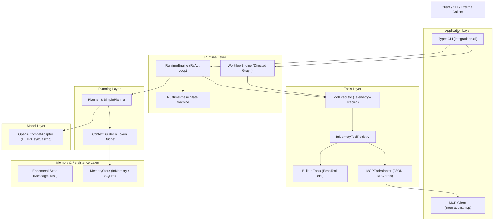

# AgentCore

<p align="center">
  <strong>A Modular, Transparent, and Observable Python Agent Runtime Built from Scratch.</strong>
</p>

<p align="center">
  
  
  
  
  
  
  
</p>

<p align="center">
  <a href="README.md"><strong>中文</strong></a> | <a href="README.en.md"><strong>English</strong></a>
</p>

---

## 📖 Overview

### What is AgentCore?
**AgentCore** 是一个从零实现的轻量级、模块化、白盒化 Python AI Agent 运行时（Agent Runtime）。它不依赖任何重型第三方 Agent 框架（如 LangChain、LangGraph、CrewAI 等），通过清晰的架构分层与显式状态机，完整实现了现代智能代理从输入规划、工具调用、记忆持久化、有向图工作流编排到标准生态接入的闭环。

### Why does it exist?
1. **打破黑盒封装**：主流 Agent 框架将状态跃迁、工具调度与 Token 预算逻辑层层包裹，排错艰难。AgentCore 坚持白盒化控制流，所有状态与生命周期清晰可见。
2. **双引擎灵活应对场景**：原生同时提供面向探索式自主决策的 **ReAct 状态机循环引擎** 与面向企业级确定性业务流的 **有向图工作流引擎（Directed Workflow Graph）**。
3. **拥抱开放标准**：拒绝私有插件生态，原生支持行业统一的 **Model Context Protocol (MCP)** 协议，实现与外部生态工具的开箱即用互联。

---

## ✨ Core Features (已实现能力)

* 🔄 **双执行引擎 (Dual Execution Engines)**：
  * **ReAct 循环引擎 (`RuntimeEngine`)**：显式 9 状态跃迁机，内置指数退避重试、多层超时保护、主动取消与敏感工具审批回调。
  * **工作流图引擎 (`WorkflowEngine`)**：支持有向图条件路由 (`WorkflowGraph`)、前置/后置断点挂起 (`interrupt`)、人工干预恢复 (`resume`) 与全生命周期时序审计回放 (`replay`)。
* ⚡ **并发执行节点 (`ParallelNode` / `ParallelToolNode`)**：
  * 基于线程池并发调度子节点与工具调用，提供确定性浅合并与命名空间合并策略，彻底消除竞态。
* 🧠 **分层记忆与 SQLite 持久化 (`MemoryStore`)**：
  * 显式区分运行状态 (`State`) 与长短期记忆 (`MemoryRecord`)，支持 `SESSION` / `USER` / `GLOBAL` 作用域隔离与 TTL 过期清理。
  * 原生基于 SQLite 实现结构化知识落盘与会话快照持久化恢复。
* 🎛️ **上下文工程与 Token 预算 (`StandardContextBuilder`)**：
  * 支持 CJK 与 ASCII 启发式 Token 估算、相关记忆按需检索注入、滑动窗口裁剪与历史截断显式通知。
* 🔌 **Model Context Protocol (MCP) 原生集成**：
  * 实现标准 `MCPClient` 契约，支持基于子进程 stdio 的 **JSON-RPC 2.0** 通信，外部 MCP 工具自动发现并适配注册为内部工具。
* 📊 **轻量级全链路可观测性 (`infra.telemetry`)**：
  * 支持双模式结构化日志（Text / JSON）、基于 ContextVars 的自动上下文透传、树状调用链路追踪 (`Tracer` / `Span`) 与指标度量 (`MetricsRegistry`)。
* 💻 **双引擎 Typer CLI**：
  * 命令行提供交互体验，一键切换 `--engine react|workflow`，支持离线 Mock 演练与真实大模型接入。

---

## 🏛️ System Architecture



---

## 💡 Core Concepts

* **`State` vs `Memory`**：`State` 是单次运行期间产生的即时上下文序列（会话与任务现场）；`Memory` 是沉淀的跨轮次、跨会话知识条目（支持作用域与过期淘汰）。
* **`RuntimeEngine` vs `WorkflowEngine`**：前者由大模型自主推演下一步动作（ReAct 循环）；后者由开发者预定义的有向图与条件谓词主导流转，支持任意节点前后挂起断点（Human-in-the-Loop）。
* **`Tool` & `Observation`**：工具契约输入严格基于 JSON Schema，执行结果封装为不可变的 `Observation`（包含成功标志、结构化内容或错误信息），自动打上关联 ID。
* **`MCP Integration`**：通过行业统一的 Model Context Protocol 标准连接外部工具服务，彻底打破单体工具硬编码限制。

---

## 📁 Project Structure

```text
AgentCore/
├── runtime/              # 核心运行时：Message/State/Task 模型、9 状态机、RuntimeEngine
├── workflow/             # 工作流引擎：WorkflowGraph、FunctionNode、ParallelNode、断点恢复与回放
├── planner/              # 规划器：Planner 协议、PlannerOutput、SimplePlanner
├── tools/                # 工具系统：Tool 契约、InMemoryToolRegistry、ToolExecutor、内置工具
├── memory/               # 记忆与上下文：MemoryRecord、InMemory/SQLite 存储、ContextBuilder
├── llm/                  # 模型抽象：LLMAdapter 协议、OpenAICompatAdapter (HTTPX)
├── integrations/         # 接入层：Typer CLI 命令行入口、MCP Client (JSON-RPC 2.0 stdio)
├── infra/                # 基础设施：集中配置 (JarvisConfig)、结构化日志、链路追踪、指标监控
├── tests/                # 自动化测试套件 (142 项全量通过测试用例)
├── docs/                 # 规范化文档库 (架构、设计、开发指南、ADR、演进路线图)
├── pyproject.toml        # 构建与工程化配置 (Hatchling, uv, Ruff, Black, pytest)
└── README.md             # 项目入口首页
```

---

## 🚀 Getting Started

### 1. 环境准备
* 运行环境：Python $\ge$ 3.12
* 推荐工具：[uv](https://github.com/astral-sh/uv) 极速包管理器

### 2. 安装与环境同步
```bash
# 同步环境与开发依赖 (pytest, ruff, black, pre-commit)
uv sync --extra dev
```

### 3. 运行测试套件
```bash
# 验证 142 个自动化测试全部通过
uv run pytest
```

### 4. 命令行交互演习 (CLI)

#### 离线演练（无需 API Key）
```bash
# 1. 离线 ReAct 状态循环对话
uv run jarvis chat --demo "你好，AgentCore"

# 2. 离线触发内置 echo 工具调用
uv run jarvis chat --demo "echo Hello AgentCore"

# 3. 离线有向图工作流引擎模式
uv run jarvis chat --demo --engine workflow "echo Testing Workflow"

# 4. 离线本地 SQLite 多轮会话持久化
uv run jarvis chat --demo --db-path "agent.db" --session-id "sess_001" "我的名字是张三"
uv run jarvis chat --demo --db-path "agent.db" --session-id "sess_001" "echo 读取会话"
```

#### 接入真实大模型 (OpenAI-compatible)
```bash
# 设置环境变量
export JARVIS_API_KEY="sk-YOUR_API_KEY"
export JARVIS_BASE_URL="https://api.openai.com/v1" # 或第三方兼容接口地址
export JARVIS_MODEL="gpt-4o-mini"

# 在线对话
uv run jarvis chat "请简述有限状态机的工作原理"

# 在线对话 + SQLite 记忆落盘持久化
uv run jarvis chat --db-path "agent.db" --session-id "my_user" "记住我喜欢 Python"
```

---

## ⚙️ Configuration

项目支持通过系统环境变量或命令行参数进行配置重载：

| 环境变量 | 命令行参数 | 默认值 | 说明 |
| :--- | :--- | :--- | :--- |
| `JARVIS_API_KEY` | `--api-key` | `None` | 大模型访问令牌（敏感信息，切勿硬编码） |
| `JARVIS_BASE_URL` | `--base-url` | `https://api.openai.com/v1` | OpenAI 兼容接口 Base URL |
| `JARVIS_MODEL` | `--model` | `gpt-4o-mini` | 目标调用模型名称 |
| `JARVIS_ENGINE` | `--engine` / `-e` | `react` | 默认执行引擎：`react` 或 `workflow` |
| `JARVIS_DB_PATH` | `--db-path` | `None` (内存) | SQLite 持久化数据库文件路径 |
| `JARVIS_SESSION_ID`| `--session-id` | `None` | 会话 ID，用于多轮对话与状态恢复 |
| `JARVIS_MAX_STEPS` | - | `8` | 单次运行允许的最大规划步数 |
| `JARVIS_LOG_FORMAT`| - | `text` | 日志格式：`text` (本地调试) 或 `json` (生产采集) |

> [!NOTE]
> 配置类目前保持平滑兼容过渡，后续将演进提供 `AGENTCORE_*` 前缀别名。

---

## 🛠️ Development & Engineering Standards

```bash
# 1. 运行代码风格检查 (Ruff)
uv run ruff check .

# 2. 格式化代码 (Black)
uv run black .

# 3. 安装与运行 Git 提交前检查 (Pre-commit)
uv run pre-commit install
uv run pre-commit run --all-files
```

---

## 🗺️ Roadmap & Current Capability Status

> [!TIP]
> **项目状态**：AgentCore 核心运行时全部 **5 个里程碑版本 (V0 ～ V4)**、共 **16 个演进阶段 (Phase 0 ～ Phase 15)** 已 **100% 全部完成交付**，并通过全量 142 项自动化测试验证。

| 版本里程碑 | 阶段 (Phase) | 核心技术能力与交付物 | 交付状态 |
| :--- | :--- | :--- | :---: |
| <br>**V0 Foundation**<br>*(架构与基础设施)*<br><br> | **Phase 0** Design Gate | 核心架构契约设计、分层规则定义、全套 ADR 架构决策体系 | ✅ Completed |
| | **Phase 1** Project Skeleton | 模块包骨架构建、uv 项目工程布局、统一入口与空包命名空间 | ✅ Completed |
| | **Phase 2** Dev Infra | 质量工程门禁（Ruff 静态代码检查、Black 格式化、pre-commit 钩子） | ✅ Completed |
| | **Phase 3** Runtime Models | 不可变领域模型设计（`Message`、`State`、`Task`，严格基于 Pydantic v2） | ✅ Completed |
| <br>**V1 Core Runtime**<br>*(核心运行时与 ReAct)*<br><br> | **Phase 4** LLM Adapter | 模型适配层（基于 HTTPX 实现 `OpenAICompatAdapter`，支持同步/异步调用） | ✅ Completed |
| | **Phase 5** Planner | 规划器协议规范与决策输出模型（`SimplePlanner`，支持 Reply/ToolCall/Clarify） | ✅ Completed |
| | **Phase 6** Tool Calling | 工具抽象契约、`InMemoryToolRegistry` 注册中心、执行器与不可变 `Observation` | ✅ Completed |
| | **Phase 7** Runtime Loop | `RuntimeEngine` 显式 9 状态跃迁机，内置指数退避重试、多层超时与敏感工具审批 | ✅ Completed |
| <br>**V2 Stateful Agent**<br>*(记忆与上下文工程)*<br><br> | **Phase 8** Memory Foundation | 作用域隔离记忆模型 `MemoryRecord`（`SESSION`/`USER`/`GLOBAL` 隔离、TTL 过期淘汰） | ✅ Completed |
| | **Phase 9** Context Budget | `StandardContextBuilder` 上下文工程，CJK/ASCII 启发式 Token 估算与滑动窗口裁剪 | ✅ Completed |
| | **Phase 10** Persistence | `SQLiteMemoryStore` 本地存储引擎，实现结构化知识落盘与会话快照持久化恢复 | ✅ Completed |
| <br>**V3 Workflow**<br>*(有向图编排与并发)*<br><br> | **Phase 11** Workflow Graph | `WorkflowGraph`、函数节点 `FunctionNode` 与条件谓词分支路由 `WorkflowEdge` | ✅ Completed |
| | **Phase 12** Breakpoints & Replay | `WorkflowEngine` 前置/后置断点挂起 (`interrupt`)、人工干预恢复 (`resume`) 与全时序审计回放 (`replay`) | ✅ Completed |
| | **Phase 13** Parallel Execution | `ParallelNode` 线程池并发调度、`ParallelToolNode` 工具并发，提供确定性浅合并与命名空间隔离 | ✅ Completed |
| <br>**V4 Production**<br>*(标准生态与生产加固)*<br><br> | **Phase 14** MCP Integration | Model Context Protocol 原生集成，基于子进程 stdio 的 JSON-RPC 2.0 通信与外部工具自动适配 | ✅ Completed |
| | **Phase 15** Production Hardening | 集中配置 (`JarvisConfig`)、双模式结构化日志、上下文透传链路追踪 (`Tracer`/`Span`)、指标度量 (`MetricsRegistry`) | ✅ Completed |

完整路线图与详细演进历程详见：[Master Evolution Roadmap](docs/roadmap/roadmap.md)。

---

## 📚 Documentation Navigation

完整的工程设计文档体系：

```text
docs/
├── architecture/                     # 架构体系文档
│   ├── overview.md                   # 系统分层架构与边界规则
│   └── runtime-flow.md               # 状态机流转时序与工作流执行流
├── design/                           # 核心专项设计文档
│   ├── domain-models.md              # 核心领域模型详述
│   ├── dual-engine.md                # 双执行引擎对比与设计剖析
│   ├── tool-and-mcp.md               # 工具契约与 MCP 协议集成设计
│   ├── memory-and-context.md         # 记忆隔离与滑动窗口上下文工程
│   └── observability.md              # 日志、分布式追踪与监控度量
├── development/                      # 开发者指引
│   ├── guide.md                      # 开发者环境搭建与测试运行指南
│   └── standards.md                  # 工程代码规范与 Git 提交规范
├── adr/                              # 架构决策记录 (Architecture Decision Records)
│   ├── ADR-001-runtime-self-build.md # ADR-001: 核心运行时自研决策
│   ├── ADR-002-layered-architecture.md# ADR-002: 七层分层解耦架构决策
│   ├── ADR-003-framework-introduction-strategy.md # ADR-003: 第三方框架引入策略
│   └── ADR-004-dual-execution-engines.md # ADR-004: 双执行引擎共存设计
├── roadmap/                          # 项目演进规划
│   └── roadmap.md                    # 真实演进路线图与能力边界
└── archive/                          # 历史归档
    └── legacy_master_plan/           # 早期 Bootstrap 阶段归档文档
```

---

## 📄 License

TBD (See repository headers)