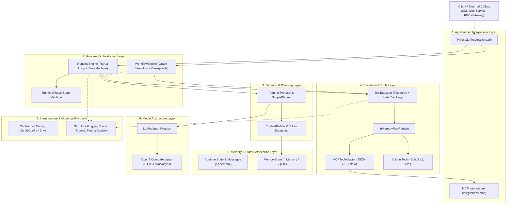

# System Architecture Overview

> 本文档描述 AgentCore 的系统分层架构、核心模块拓扑、职责边界与依赖规则。

---

## 1. 架构定位与设计哲学

**AgentCore** 是一个从零实现的模块化、可观测 Python Agent Runtime 内核。

不同于高度封装的第三方 Agent 框架（如 LangChain、CrewAI），AgentCore 采用**显式状态机**与**白盒数据流**设计：
* **无黑盒抽象**：所有状态流转、工具调用、Token 预算及工作流中断均直接受代码控制。
* **双执行引擎**：同时原生支持 **ReAct 单 Agent 状态循环引擎**与**有向图工作流编排引擎 (Directed Workflow Graph)**。
* **严格分层与单向依赖**：上层组件消费下层组件，核心内核完全解耦于外部通信客户端与框架。

---

## 2. 系统整体分层架构

AgentCore 划分为 7 个清晰的功能层级：

---

## 3. 各层职责与核心模块

| 层级 | 涉及模块 | 核心职责 | 核心类 / 协议 |
| :--- | :--- | :--- | :--- |
| **Application** | `integrations/cli`, `integrations/mcp` | 客户端交互入口、参数解析、组合根 (Composition Root) 组装、MCP 协议端点通信 | `app` (Typer), `MCPClient`, `StdioMCPClient` |
| **Runtime** | `runtime/` | 驱动 Agent 生命周期、状态机流转控制、重试/超时/人工审批、图工作流调度 | `RuntimeEngine`, `AgentLoop`, `RuntimePhase` |
| **Workflow** | `workflow/` | 支持有向图执行、条件分支路由、断点暂停 (Interrupt)、人工恢复 (Resume)、并行节点合并 | `WorkflowGraph`, `WorkflowNode`, `WorkflowEngine`, `ParallelNode` |
| **Planning** | `planner/` | 基于只读 State 和上下文决策下一步动作 (`reply` / `tool_call` / `clarify`) | `Planner`, `SimplePlanner`, `PlannerOutput` |
| **Tools** | `tools/` | 工具标准契约定义、工具注册中心、执行状态追踪与耗时度量 | `Tool`, `ToolDefinition`, `ToolRegistry`, `ToolExecutor` |
| **Memory** | `memory/` | 运行时会话上下文管理、Token 预算裁剪、长短期记忆存储与 SQLite 持久化 | `MemoryStore`, `SQLiteMemoryStore`, `StandardContextBuilder` |
| **LLM** | `llm/` | 统一大模型 API 调用契约，解耦底层具体 Provider | `LLMAdapter`, `OpenAICompatAdapter` |
| **Infra** | `infra/` | 全局环境变量配置注入、结构化日志、轻量级分布式追踪 Span 与指标统计 | `JarvisConfig`, `StructuredLogger`, `Tracer`, `MetricsRegistry` |

---

## 4. 依赖规则与设计边界

为了保证核心内核的独立性与可测试性，代码库严格遵循以下依赖约束：

1. **单向向下依赖**：
   * Application (`integrations`) 充当组装者，依赖底层所有模块。
   * Runtime 不得依赖具体的 Application 实现。
   * Planning、Tools、Memory 之间保持松耦合，仅通过 `runtime.models` 暴露的标准不可变领域对象通信。
2. **State 与 Memory 严格隔离**：
   * `State`：单次运行的即时上下文（包含本次运行产生的 messages、observations、tool_calls、planner_outputs），生命周期与单次 Run / Session 绑定。
   * `Memory`：持久化或跨 Run 的知识条目（包含 key、content、scope、expires_at），通过 `MemoryStore` 单独存取。
3. **只读 Planning 约束**：
   * Planner 只能读取 `State` 和 `Memory`，**严禁在 `plan()` 方法内部直接修改 State 或执行 Tool**。
4. **外部集成协议解耦**：
   * 外部工具仅通过 MCP 协议（JSON-RPC 2.0 stdio）接入，经过 `MCPToolAdapter` 适配为内部 `Tool`，不污染内核工具注册协议。
