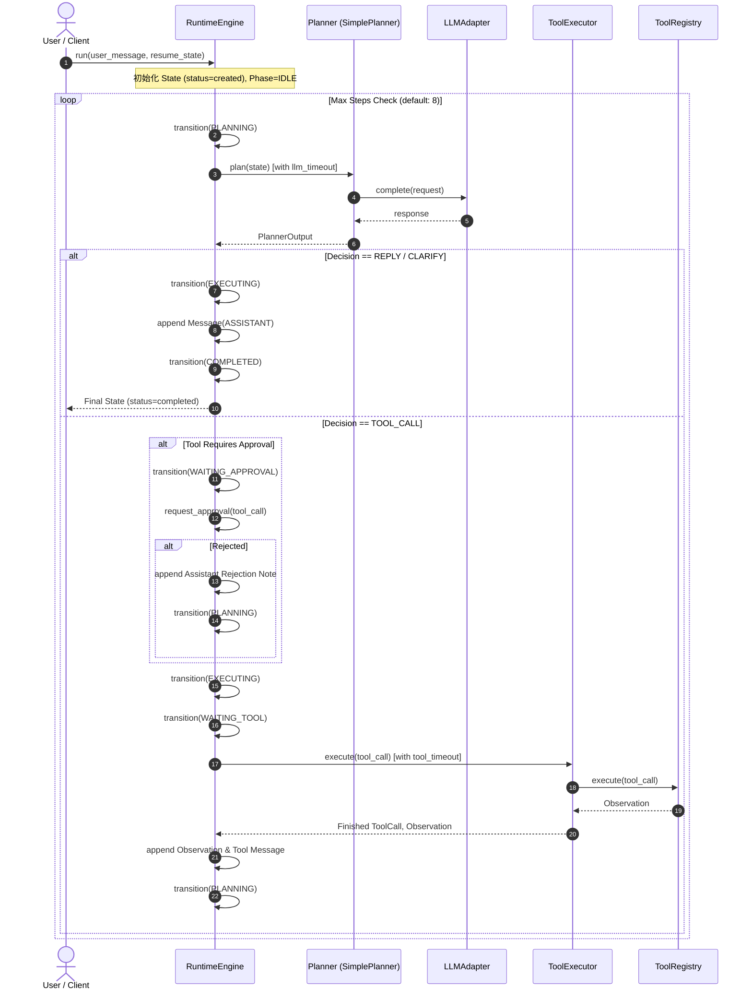
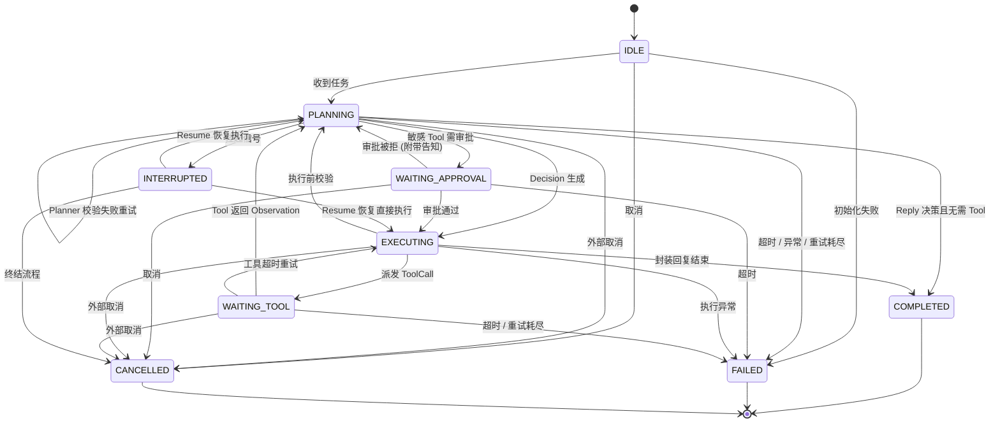

# Runtime Execution Flow & State Machine

> 本文档深入描述 AgentCore 的两种执行流：**ReAct 状态机主循环**与**有向图工作流执行流**，包含状态流转、重试、超时与中断恢复机制。

---

## 1. ReAct 运行时主循环 (RuntimeEngine)

`RuntimeEngine` 实现了严密的 ReAct（Reasoning + Acting）单 Agent 状态循环，并内建完整的异常边界保护（超时、指数退避重试、主动取消、敏感工具审批）。

### 1.1 执行流时序



---

## 2. RuntimePhase 状态机规范

`runtime/state_machine.py` 严格定义了合法状态与跃迁规则，任何非法跃迁均会抛出 `InvalidTransitionError`。

### 2.1 状态定义

| 状态 (RuntimePhase) | 对应 State.status | 触发条件 / 职责 |
| :--- | :--- | :--- |
| `IDLE` | `None` (未开始) | 引擎初始化就绪，等待处理输入 |
| `PLANNING` | `running` | 正在调用 Planner 及 LLM 分析当前上下文 |
| `EXECUTING` | `running` | 决策解析完毕，正在准备执行动作（调用工具或组装答复） |
| `WAITING_TOOL` | `waiting_tool` | 工具已派发，正在等待工具执行完毕返回 `Observation` |
| `WAITING_APPROVAL` | `running` | 命中敏感工具权限名单，挂起等待用户/系统确认 |
| `INTERRUPTED` | `running` | 工作流被断点或外部信号暂停，保留执行现场 |
| `COMPLETED` | `completed` | 流程圆满完成，已产生最终 Assistant 回复（终态） |
| `FAILED` | `failed` | 遭遇不可恢复异常、重试耗尽或超时（终态） |
| `CANCELLED` | `cancelled` | 外部主动请求取消（终态） |

### 2.2 状态转移图



---

## 3. 容错与控制策略

### 3.1 指数退避重试 (Exponential Backoff)
* **Planner 异常 / Pydantic 校验失败**：支持至多 `max_retries`（默认 3 次），间隔按 `retry_backoff_seconds * (2 ^ (retry - 1))` 递增。
* **工具执行失败 / 超时**：若 `observation.success == False` 或工具发生 `FuturesTimeout`，进入退避重试流程。

### 3.2 多层超时防御 (Timeout Guard)
* **LLM 调用超时 (`llm_timeout`)**：默认 60s，防 LLM 无响应挂起。
* **工具调用超时 (`tool_timeout`)**：默认 30s，防网络 I/O 或外部命令死锁。
* **单次 Run 总超时 (`run_timeout`)**：默认 300s，防无限循环死锁。

### 3.3 协作式主动取消 (Cooperative Cancellation)
* 调用 `engine.cancel(state_id)` 会向取消集合注册目标 `state_id`。
* 在循环的每一个关键检查点（规划前、规划后、工具调用前），引擎都会检查取消标记，保证状态安全收敛至 `RuntimePhase.CANCELLED` 并持久化。

---

## 4. 有向图工作流执行流 (WorkflowEngine)

除单 Agent 循环外，AgentCore 还提供了基于 `WorkflowGraph` 的有向图编排引擎，支持确定性流水线、条件路由与人机协同。

```mermaid
flowchart TD
    Start([Start]) --> Entry[Entry Node]
    Entry --> Step1{Evaluate Outgoing Edges}
    Step1 -->|Condition A| NodeA[Node A: Functional / Parallel]
    Step1 -->|Condition B| NodeB[Node B]
    
    NodeA --> BreakCheck{Hit Breakpoint?}
    BreakCheck -->|interrupt_before / __interrupt__| Paused[Status: INTERRUPTED<br>Save Snapshot]
    BreakCheck -->|No Breakpoint| Exec[Execute Node Logic]
    
    Exec --> NodeAudit[Record Step to History]
    NodeAudit --> Step2{Next Edge?}
    Step2 -->|Next Node Exists| BreakCheck
    Step2 -->|No Target / Terminal| Done([Status: COMPLETED])
    
    Paused -.->|External Resume(run_id, input)| Step2
```

### 4.1 断点中断与恢复 (Interrupt & Resume)
* **前置断点 (`interrupt_before={node_id}`)**：在指定节点执行前挂起。
* **后置断点 (`interrupt_after={node_id}` 或 `context["__interrupt__"] = True`)**：在节点执行完毕后挂起，供人工审批其输出。
* **状态恢复 (`engine.resume(run_id, input={...})`)**：向挂起的工作流注入更新后的输入参数并无缝继续向下流转。
* **可审计回放 (`engine.replay(run_id)`)**：返回从第 0 步到终态的所有 `WorkflowStepRecord` 历史快照（包含每一步的输入输出 Context 及绝对时间戳）。
