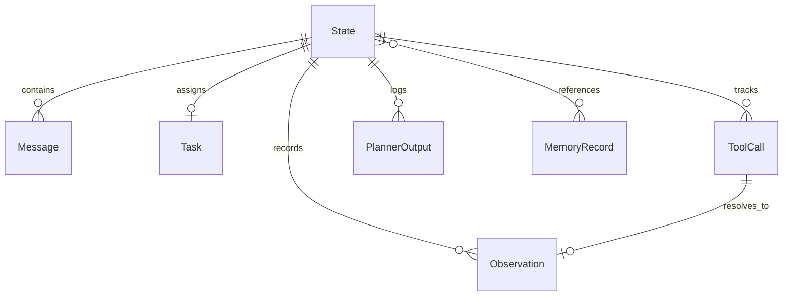

# Domain Models Design

> 本文档详细定义 AgentCore 核心领域对象的数据契约、不变性约束与生命周期。所有模型均采用 Pydantic v2 实现。

---

## 1. 领域对象全景

---

## 2. 核心模型规范

### 2.1 Message (`runtime.models.Message`)
对话与交互历史的基石单元。

* **不可变约束**：设置 `model_config = ConfigDict(frozen=True)`。消息一旦创建不可修改，历史必须通过只读追加保证幂等性与可审计性。
* **字段定义**：
  * `id: str`：UUID 唯一标识（默认自动生成）。
  * `role: MessageRole`：枚举值：`user`、`assistant`、`system`、`tool`。
  * `content: str`：消息正文。
  * `metadata: dict[str, Any]`：用于存放 `tool_call_id`、`tool_name` 等附加追踪信息。
  * `created_at: datetime`：UTC 创建时间戳。

### 2.2 State (`runtime.models.State`)
单次 Agent 运行实例（Run）的完整上下文载体。

* **字段定义**：
  * `id: str`：运行实例或 Session 唯一标识。
  * `status: StateStatus`：当前运行状态，可选值：`created`、`running`、`waiting_tool`、`completed`、`failed`、`cancelled`。
  * `messages: list[Message]`：对话历史序列。
  * `task: Task | None`：当前绑定的任务结构。
  * `tool_calls: list[ToolCall]`：本次运行产生的所有工具调用记录。
  * `observations: list[Observation]`：工具执行返回的结果记录。
  * `planner_outputs: list[Any]`：Planner 历史推理输出记录。
  * `memory_refs: list[str]`：显式关联的 `MemoryRecord.id` 列表。
  * `error: str | None`：当状态为 `failed` 时记录的具体错误信息。
  * `created_at: datetime` / `updated_at: datetime`：UTC 时间戳。
* **生命周期演进**：
  $$\text{created} \longrightarrow \text{running} \longleftrightarrow \text{waiting\_tool} \longrightarrow \{\text{completed}, \text{failed}, \text{cancelled}\}$$

### 2.3 Task (`runtime.models.Task`)
高阶任务与子任务树形结构。

* **字段定义**：
  * `id: str`：任务 UUID。
  * `description: str`：任务详述。
  * `goal: str`：明确的任务交付目标。
  * `status: TaskStatus`：枚举值：`pending`、`in_progress`、`completed`、`failed`。
  * `subtasks: list[Task]`：递归子任务列表（为复杂工作流任务拆解预留）。

### 2.4 PlannerOutput (`planner.base.PlannerOutput`)
Planner 每次推演的标准化决策。通过 Pydantic `@model_validator(mode="after")` 保证强约束：

* `DecisionType.REPLY`：必须包含非空 `content`。
* `DecisionType.TOOL_CALL`：必须包含有效的 `tool_call` 对象。
* `DecisionType.CLARIFY`：必须包含非空 `clarify_message`。

### 2.5 ToolCall 与 Observation (`tools.base`)
* **ToolCall**（`frozen=True`）：
  * `id: str`：调用唯一标识。
  * `tool_name: str`：调用的目标工具名称。
  * `arguments: dict[str, Any]`：参数字典。
  * `status: ToolCallStatus`：`pending` $\rightarrow$ `running` $\rightarrow$ `completed` / `failed`。
* **Observation**（`frozen=True`）：
  * `id: str`：观察记录 UUID。
  * `tool_call_id: str`：强关联对应的 `ToolCall.id`。
  * `success: bool`：工具执行是否成功。
  * `content: str | dict[str, Any]`：工具返回的文本或结构化数据。
  * `error: str | None`：执行异常详情。

### 2.6 MemoryRecord (`memory.models.MemoryRecord`)
持久化知识条目。

* **字段定义**：
  * `id: str`：记录 UUID。
  * `key: str`：检索关键字。
  * `content: str`：记忆内容。
  * `scope: MemoryScope`：记忆隔离作用域：
    * `SESSION`：仅在当前会话可见。
    * `USER`：属于当前用户，跨会话共享。
    * `GLOBAL`：系统全局共享。
  * `embedding_ref: str | None`：未来向量检索索引预留引用。
  * `expires_at: datetime | None`：过期绝对时间，提供 `is_expired()` 校验方法。
