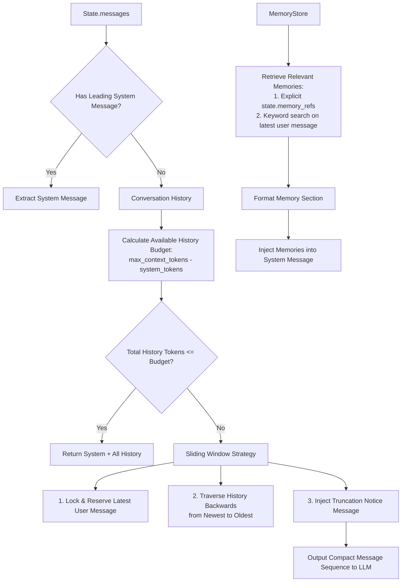

# Memory & Context Engineering Design

> 本文档描述 AgentCore 的记忆与上下文工程体系，包括 State 与 Memory 的清晰职责划分、记忆作用域隔离、SQLite 持久化以及滑动窗口 Token 预算控制。

---

## 1. 核心边界：State vs Memory

很多 Agent 系统将“状态”与“记忆”混为一谈，导致持久化脏数据或上下文无限污染。AgentCore 对此做出了显式的职责隔离：

| 维度 | `State` (运行状态) | `Memory` (记忆系统) |
| :--- | :--- | :--- |
| **生命周期** | 与单次 Agent 运行或轮次强绑定，属于即时运行现场 | 跨轮次、跨会话长期存在，支持按需检索与过期淘汰 |
| **存储数据** | 未压缩的全部 `Message`、待决 `Task`、`ToolCall`、`Observation` 原始序列 | 经过提取沉淀的实体知识条目 (`key`, `content`, `scope`) |
| **访问模式** | 引擎在主循环中实时追加与只读分析 | Planner 通过 `ContextBuilder` 按相关性按需检索与注入 |
| **数据契约** | `runtime.models.State` | `memory.models.MemoryRecord` |

---

## 2. 记忆作用域隔离 (`MemoryScope`)

为了防止用户私有信息外溢或跨会话数据污染，每条 `MemoryRecord` 必须严格指定作用域：

* `MemoryScope.SESSION`：仅在当前对话会话内有效，会话销毁后即失效。
* `MemoryScope.USER`：与特定用户标识绑定，同一用户的跨会话持久留存（如用户语言偏好、编码习惯）。
* `MemoryScope.GLOBAL`：全系统共享公共常识或预置知识。

---

## 3. 存储实现 (`MemoryStore`)

### 3.1 内存存储 (`InMemoryMemoryStore`)
* 基于 `threading.RLock` 实现多线程安全。
* **唯一键索引防污染**：维护 `(key, scope)` 索引字典，同 scope 下写入相同 key 会原子覆盖旧记录，防止陈旧矛盾记忆累积。
* **启发式检索排序**：支持对 `key` 和 `content` 的大小写不敏感匹配，优先匹配精确 key，次之匹配子串，最后按时间倒序排序。
* **TTL 过期清理**：支持 `cleanup_expired()` 原子移除非持久化过期记忆。

### 3.2 SQLite 持久化存储 (`SQLiteMemoryStore`)
适用于单机服务与 CLI 本地多轮对话恢复：
* 采用 Python 标准库 `sqlite3`，零额外第三方依赖。
* **数据库表设计**：
  * `memory_records` 表：存储各 scope 下的结构化知识，并在 `(key, scope)` 建立唯一索引。
  * `states` 表：存储状态快照（`id`, `data` (JSON), `updated_at`），支持通过 `save_state(state)` 与 `load_state(session_id)` 恢复任意历史会话现场。

---

## 4. 上下文工程与 Token 预算 (`StandardContextBuilder`)

当对话轮次变长、工具输出庞大时，直接向大模型传递全部历史必然引发 Context 溢出与费用飙升。`StandardContextBuilder` 负责在 LLM 请求前构建压缩、合规的上下文。

### 4.1 核心构建算法

### 4.2 启发式 Token 估算器 (`default_token_estimator`)
* 中文字符 / CJK：每个字符约计 1 Token。
* 拉丁字母 / ASCII：约每 4 个字符计 1 Token。
* 消息结构开销：单条消息额外增加 4 Tokens 结构预留。

### 4.3 滑动窗口保证原则
1. **系统提示词永不截断**：System 提示词具有最高优先级。
2. **相关记忆优先注入**：检索到的关键条目直接注入至 System Section。
3. **最新用户意图严格保全**：无论历史多长，用户的最近一次提问绝对保证进入上下文。
4. **显式截断标记**：历史消息被裁剪时，自动在保留历史头部插入 `[Context: Earlier conversation history was truncated due to token budget limit.]`，避免模型产生认知割裂。
