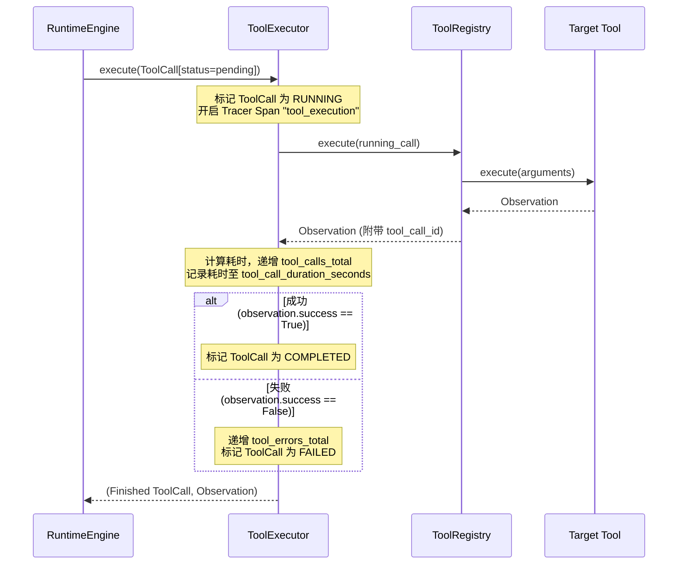

# Tools & MCP Integration Design

> 本文档描述 AgentCore 的工具契约体系、执行追踪机制以及 Model Context Protocol (MCP) 标准集成设计。

---

## 1. 内部工具契约与生命周期

AgentCore 定义了一套轻量且严格的工具协议 (`tools.base.Tool`)：

```python
class Tool(Protocol):
    @property
    def definition(self) -> ToolDefinition:
        """返回符合 JSON Schema 的工具元数据描述。"""
        ...

    def execute(self, arguments: dict[str, Any]) -> Observation:
        """同步执行工具并返回不可变的 Observation。"""
        ...

    async def aexecute(self, arguments: dict[str, Any]) -> Observation:
        """异步执行预留接口。"""
        ...
```

### 1.1 ToolDefinition 结构
```python
class ToolDefinition(TypedDict):
    name: str                  # 工具全局唯一名称（例如 "echo"）
    description: str           # 工具功能描述，供大模型决策使用
    parameters: dict[str, Any] # 描述入参结构的 JSON Schema
```

### 1.2 执行追踪与 ToolExecutor

工具调用不直接由业务层裸调，而是必须经由 `ToolExecutor` 统一包装：



---

## 2. 注册中心 (`InMemoryToolRegistry`)

`tools.registry.InMemoryToolRegistry` 维护系统当前加载的所有工具：
* **名称防重**：同一名字重复注册时抛出 `ValueError("tool already registered: ...")`。
* **未知工具安全隔离**：如果调用未注册的工具名，不抛出不可控崩溃，而是安全返回 `Observation(success=False, error="unknown tool: ...")`，以便 Planner 感知并进行容错修正。
* **ID 强绑定**：自动将外部 `tool_call.id` 盖戳回写至 `Observation.tool_call_id`。

---

## 3. Model Context Protocol (MCP) 集成

为了与快速发展的外部工具生态兼容，AgentCore 在 `integrations/mcp` 中实现了官方规范级别的 MCP 客户端与适配器。

### 3.1 MCPClient 协议与实现

```python
class MCPClient(Protocol):
    def discover_tools(self) -> list[ToolDefinition]: ...
    def call_tool(self, name: str, arguments: dict[str, Any]) -> Observation: ...
    def list_resources(self) -> list[dict[str, Any]]: ...
    def read_resource(self, uri: str) -> str: ...
```

系统内建两种实现：
1. **`InMemoryMCPClient`**：内存型虚拟客户端，用于单元测试或快速构建进程内 Mock 服务。
2. **`StdioMCPClient`**：标准的子进程 stdio 客户端。
   * 通过标准 I/O 与独立外部进程（如 Node.js / Python 编写的 MCP Server）通信。
   * 采用 **JSON-RPC 2.0** 协议规范序列化与反序列化请求响应。
   * 支持连接生命周期管理（`start()` / `close()` / 进程健康度检测）。

### 3.2 外部工具动态桥接 (`MCPToolAdapter`)

外部 MCP 工具不需要重写代码即可无缝接入 AgentCore：

```python
from integrations.mcp import StdioMCPClient, register_mcp_client
from tools.registry import InMemoryToolRegistry

# 1. 启动外部 MCP Server 进程
mcp_client = StdioMCPClient(command=["npx", "-y", "@modelcontextprotocol/server-filesystem", "/data"])

# 2. 一键发现工具并动态适配注入 Registry
registry = InMemoryToolRegistry()
registered_tools = register_mcp_client(registry, mcp_client)
# registered_tools: ["read_file", "write_file", "list_directory", ...]
```

`MCPToolAdapter` 实现了内核 `Tool` 协议，把底层 JSON-RPC 的 `tools/call` 调用直接包装为 AgentCore 标准的 `Observation`，实现了**内核工具协议与外部通信协议的彻底解耦**。
