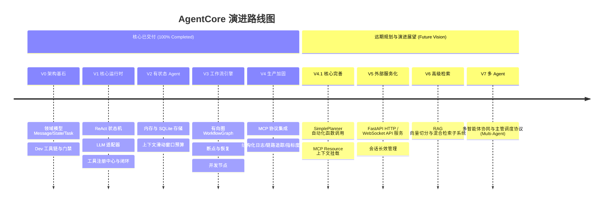

# AgentCore Evolution Roadmap

> 本文档记录 AgentCore 的真实研发演进历程、当前实际能力边界与未来阶段规划。
> **原则**：禁止将未实现的能力误写为已实现，所有状态必须以当前实际代码和测试覆盖为依据。

---

## 1. 能力演进全景总览

---

## 2. 详细演进阶段与真实状态

### 2.1 [已交付] V0 — Foundation (架构与基础设施)
* ✅ **数据建模**：定义不可变 `Message`、`State`、`Task` Pydantic v2 模型（`runtime/models.py`）。
* ✅ **工程工具链**：配置 uv、pytest、pytest-asyncio、Ruff、Black 与 pre-commit 提交门禁。
* ✅ **架构契约设计**：建立分层架构设计准则与初始 ADR 决策记录。

### 2.2 [已交付] V1 — Core Runtime (核心运行时与 ReAct 闭环)
* ✅ **大模型适配器**：实现基于 HTTPX 的 `OpenAICompatAdapter`，支持自定义 base_url、api_key 与超时（`llm/`）。
* ✅ **规划器协议**：建立 `Planner` 协议及 `PlannerOutput`（支持 `reply`, `tool_call`, `clarify`）（`planner/`）。
* ✅ **工具契约与执行**：建立 `Tool`、`InMemoryToolRegistry`、`ToolExecutor` 与内置 `EchoTool`（`tools/`）。
* ✅ **ReAct 引擎与状态机**：实现 `RuntimeEngine` 与 `RuntimePhase` 9 状态跃迁机，内建指数退避重试、主动取消、多层超时与工具审批回调（`runtime/`）。
* ✅ **CLI 交互初版**：基于 Typer 提供 `chat` 命令行体验（`integrations/cli/`）。

### 2.3 [已交付] V2 — Stateful Agent (记忆与持久化)
* ✅ **作用域记忆**：实现 `MemoryRecord` 与 `MemoryScope`（SESSION / USER / GLOBAL 隔离）（`memory/models.py`）。
* ✅ **内存与持久化存储**：
  * `InMemoryMemoryStore`：线程安全，`(key, scope)` 索引防覆盖，启发式检索排序与 TTL 清理。
  * `SQLiteMemoryStore`：SQLite 本地存储，支持结构化知识落盘及 State 快照序列化恢复（`memory/sqlite.py`）。
* ✅ **上下文工程**：`StandardContextBuilder` 提供 CJK/ASCII 启发式 Token 估算、相关记忆注入、滑动窗口裁剪与截断通知（`memory/context.py`）。

### 2.4 [已交付] V3 — Workflow Engine (有向图编排与并发)
* ✅ **有向图模型**：实现 `WorkflowNode`、`FunctionNode`、`WorkflowEdge`（支持条件谓词路由）与 `WorkflowGraph`（`workflow/node.py`, `workflow/edge.py`）。
* ✅ **断点与时序回放**：`WorkflowEngine` 支持前置断点（`interrupt_before`）、后置断点（`interrupt_after` / `__interrupt__`）、人工注入恢复（`resume`）以及全生命周期执行审计回放（`replay`）（`workflow/engine.py`）。
* ✅ **并发节点与合并策略**：
  * `ParallelNode`：基于线程池并发调度子节点，提供确定性浅合并与命名空间合并（`workflow/parallel.py`）。
  * `ParallelToolNode`：并发调用多个工具并聚合观察结果。

### 2.5 [已交付] V4 — Production & MCP (标准生态与可观测性)
* ✅ **Model Context Protocol (MCP)**：
  * 实现 `MCPClient` 协议，提供 `InMemoryMCPClient` 与基于子进程 stdio JSON-RPC 2.0 的 `StdioMCPClient`。
  * 提供 `MCPToolAdapter` 与 `register_mcp_client`，外部 MCP 工具自动发现并适配注册为内部工具（`integrations/mcp/`）。
* ✅ **集中配置**：`JarvisConfig` / `get_config()` 支持完整环境变量映射重载（`infra/config.py`）。
* ✅ **全链路可观测性**：
  * 结构化日志：`StructuredLogger`（支持 Text 调试与 JSON 格式，ContextVars 自动透传）。
  * 分布式调用追踪：轻量级内存 `Tracer` 与 `Span`，支持树状父子跨度与耗时统计。
  * 性能度量：`MetricsRegistry` 收集计数器、瞬时量与执行延迟分布（`infra/telemetry.py`）。
* ✅ **双引擎 CLI 支持**：CLI 支持 `--engine react|workflow` 自由切换，集成 SQLite 记忆持久化（`--db-path`, `--session-id`）。

---

## 3. 核心完工后的演进展望 (Post-V4 Future Enhancements)

项目立项设定的核心交付目标（V0 ~ V4 / Phase 0 ~ 15）已 **100% 全部完成交付**。以下列出的是针对长线开源演进与生态扩展的规划项：

| 模块 | 当前状态 | 目标形态 | 阶段 |
| :--- | :--- | :--- | :--- |
| **LLM 原生函数调用** | `SimplePlanner` 目前仅将用户输入传给 LLM 并直接返回 `REPLY`。实际工具调用目前主要由 `DemoPlanner` 或工作流有向图触发。 | 在 `OpenAICompatAdapter` 中注入工具 JSON Schema，使 `SimplePlanner` 能解析模型返回的 `tool_calls` 并自动转化为 `PlannerOutput(decision_type=TOOL_CALL)`。 | V4.1 |
| **MCP Resource 上下文挂载** | `MCPClient` 已实现 `list_resources` 与 `read_resource`，但尚未自动挂接到 `ContextBuilder` 中。 | 将外部 MCP 资源作为动态参考资料自动检索并注入系统提示词。 | V4.1 |
| **服务命名收尾统一** | 代码配置类名为 `JarvisConfig`，环境变量前缀仍为 `JARVIS_*`，CLI 脚本入口注册为 `jarvis`。 | 渐进式平滑过渡支持 `AGENTCORE_*` 环境变量别名与 `agentcore` 命令行。 | V4.1 |

---

## 4. 后续版本规划 (Planned)

### V5 — 外部服务化与接入网关 (API Gateway)
* 🚀 **FastAPI HTTP / WebSocket 服务**：提供标准的 RESTful 端点（`/v1/chat`, `/v1/runs`, `/v1/workflows`）。
* 🚀 **流式推送 (SSE)**：支持 Token 级别流式返回与执行状态机实时推进通知。
* 🚀 **长任务异步轮询**：支持长时间运行的任务异步派发与结果拉取。

### V6 — 知识库与 RAG 检索子系统 (Retrieval-Augmented Generation)
* 🚀 **文档解析与分块器**：集成文本、Markdown 与代码分块算法。
* 🚀 **向量模型适配层**：构建 `EmbeddingAdapter` 契约。
* 🚀 **向量存储后端**：支持本地向量库（如 FAISS / Chroma / SQLite-vec）与混合关键词检索。

### V7 — 多智能体协同编排 (Multi-Agent Swarm / Hierarchical)
* 🚀 **智能体间通信协议**：定义 Agent-to-Agent 消息与任务交接标准。
* 🚀 **主管协调器 (Supervisor)**：基于 `WorkflowGraph` 调度多个领域子 Agent 协同完成复杂工程目标。

---

## 5. 明确不支持的边界 (Not Supported)

为了保持 AgentCore 作为纯粹、轻量、高可控运行时的定位，以下内容明确不在项目目标之内：
* ❌ **模型训练与微调 (Training / Fine-tuning)**：专注于推理时的运行时编排。
* ❌ **超大规模分布式集群调度 (Distributed Cluster Orchestrator)**：不与 Kubernetes、Ray 或 Celery 深度耦合；单实例设计为轻量微内核。
* ❌ **专有云厂商深度绑定**：所有组件保持开源中立，零专属云依赖。
